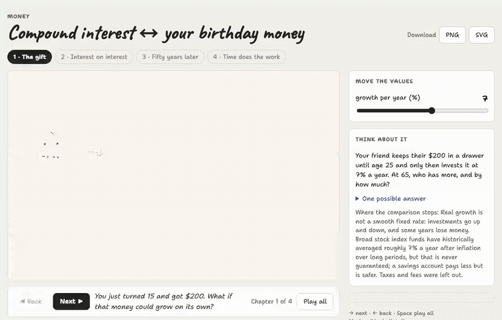
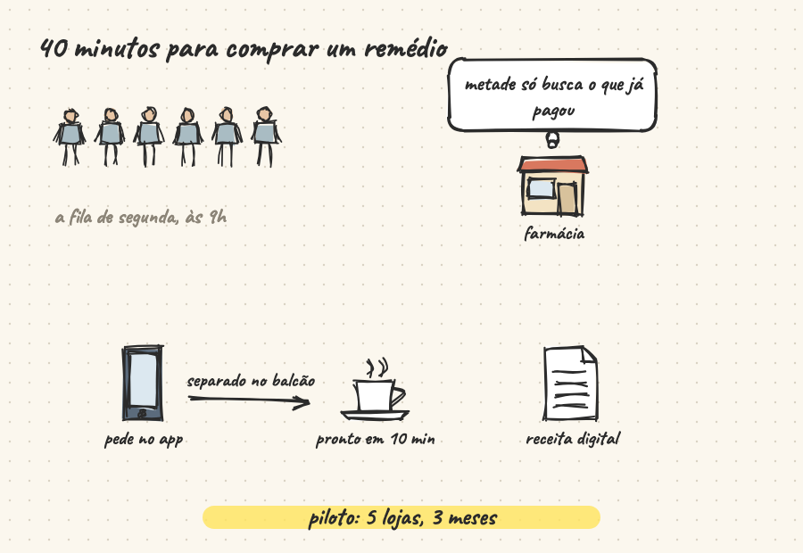
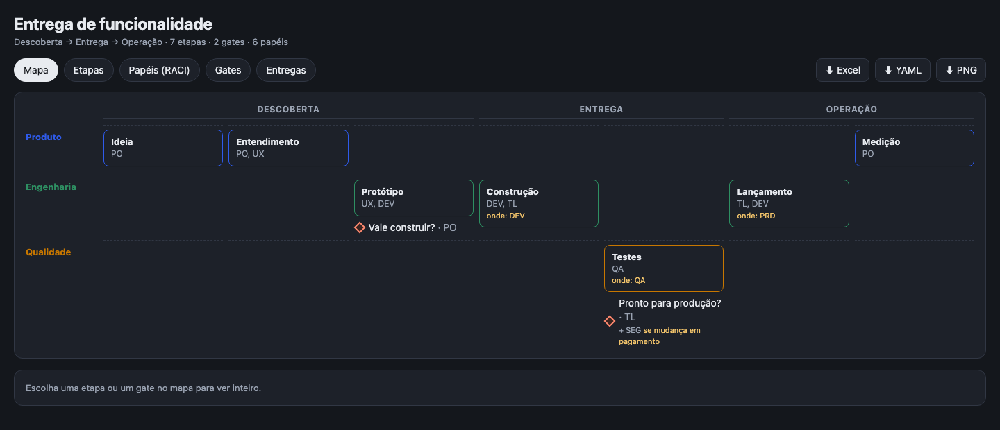

<h1 align="center">house-lights</h1>

<p align="center"><b>The lights that come up so everyone can see. Six skills for Claude that show an idea to people — by
drawing it, playing it, mapping it or comparing it — each one an HTML file that opens offline.</b></p>

<p align="center">
  
</p>

<p align="center">
  A Claude Code plugin of <a href="https://agentskills.io">Agent Skills</a>, also for claude.ai, the Claude API and other
  tools that load skills.<br><a href="https://ruinosus.github.io/house-lights/">Open the gallery</a> to play every example.
</p>

---

## The six skills

| Skill | Ask for | You get |
|---|---|---|
| [chalk-talk](dev/chalk-talk/README.md) | "explain compound interest by drawing it" | a hand-drawn lesson that appears stroke by stroke, chapter by chapter, with values you can move |
| [back-of-napkin](dev/back-of-napkin/README.md) | "draw the architecture so I can present it to the client" | a pitch, an architecture, a decision, data, a timeline or a story drawn to be shown — it opens presenting, and becomes a PowerPoint |
| [dress-rehearsal](dev/dress-rehearsal/README.md) | "make a drill from our checkout runbook" | an incident drill to play, with a clock and choices, and a debrief of what the runbook does not say |
| [gates-and-handoffs](dev/gates-and-handoffs/README.md) | "who approves what in our delivery?" | a team's way of working — stages, gates, roles, outputs — as a checkable file, a map, a workbook and a lesson |
| [service-blueprint](dev/service-blueprint/README.md) | "where does our onboarding hurt?" | a customer journey and who makes each moment happen on stage, backstage and in the systems |
| [cast-list](dev/cast-list/README.md) | "which of our Copilot Studio agents is off the pattern?" | the agents compared: what repeats, who is off it, what only one has — a map, a workbook to decide in, and a lesson; Node alone, no model |

Claude picks the skill by what you ask. To call one by name: `/house-lights:back-of-napkin …`.

<p align="center">
  
  
</p>

## Install

**Claude Code** — all six at once:

```
/plugin marketplace add ruinosus/house-lights
/plugin install house-lights@house-lights
```

**claude.ai** — each skill is a zip in the [latest release](https://github.com/ruinosus/house-lights/releases)
(`chalk-talk.zip`, `back-of-napkin.zip`, …): Settings › Capabilities › Skills › Upload, with code execution on.
**Claude API**: the same zips with the Skills API. **Other tools** (Codex, Copilot, Cursor, Gemini CLI…): copy
`skills/<skill>` where the tool reads skills; they need Node.js 18 or later.

**npm** — the same builds, outside Claude:

```
npx house-lights back-of-napkin pitch.chalk --pptx steps
npx house-lights gates-and-handoffs team.way.yaml --all
npx house-lights cast-list agents/ --all
```

The drawing engine alone, to embed lessons in a page, is the [chalk-talk](https://www.npmjs.com/package/chalk-talk)
package (it also powers the VS Code and Obsidian extensions).

## Moved here

These skills had a repository each until 1.0.0. `stage-door` is now **gates-and-handoffs** and `front-of-house` is
**service-blueprint**; their files keep working (the formats did not change). If you installed one of the old
plugins, install `house-lights` instead and remove the old one (`/plugin uninstall <old>@<old>`); the npm packages
`back-of-napkin`, `stage-door`, `front-of-house` and `dress-rehearsal` point to `npx house-lights`.

## Em português

Seis skills para mostrar uma ideia a alguém: **chalk-talk** ensina desenhando, **back-of-napkin** desenha para
apresentar (e vira PowerPoint), **dress-rehearsal** transforma o runbook num ensaio de incidente, **gates-and-handoffs**
mapeia o jeito de trabalhar do time, **service-blueprint** mapeia a jornada do cliente e **cast-list** compara os
agentes do Copilot Studio (o que se repete, quem está fora do padrão). Peça em português ("desenha a
decisão entre as duas opções", "monta o blueprint da devolução"): a tela segue o idioma da receita. A instalação é a
de cima.

## Develop

The six skills are npm workspaces; each one's tools are in `dev/<skill>/tools`.

```
npm install
npm run assets      # the generated files of each skill (chalk-talk first: the others take its engine from here)
npm run check       # every skill's checks, and dev/house-lights: one version, the npm package, npx house-lights
npm run typecheck
npm run site        # docs/: a gallery per skill and the front page
npm run zip         # dist/<skill>.zip for claude.ai and dist/house-lights.zip
npm run linux       # the builds as in a cloud sandbox (Linux, root, Playwright's Chromium); needs Docker
npm run audit       # before a push: no name from your local list in the tracked files
claude plugin eval . --allow-tools Bash Write Edit --runs 1   # the evals in evals/, all six skills loaded
```

The engine's source is not published yet, so `npm run assets` works only where it is; everything else works from
this repository alone. What changed: [CHANGELOG.md](CHANGELOG.md); before 1.0.0, `dev/<skill>/CHANGELOG.md`.

## License

MIT. Third parties: Rough.js (MIT); the fonts Caveat and Shantell Sans (SIL Open Font License); lottie-web (MIT); the
animated emoji are Animated Noto Emoji by Google (CC BY 4.0); pptxgenjs (MIT, with JSZip under MIT); the Copilot Studio
schema and its reader in `skills/cast-list/vendor/microsoft` (MIT, Microsoft Corporation).
