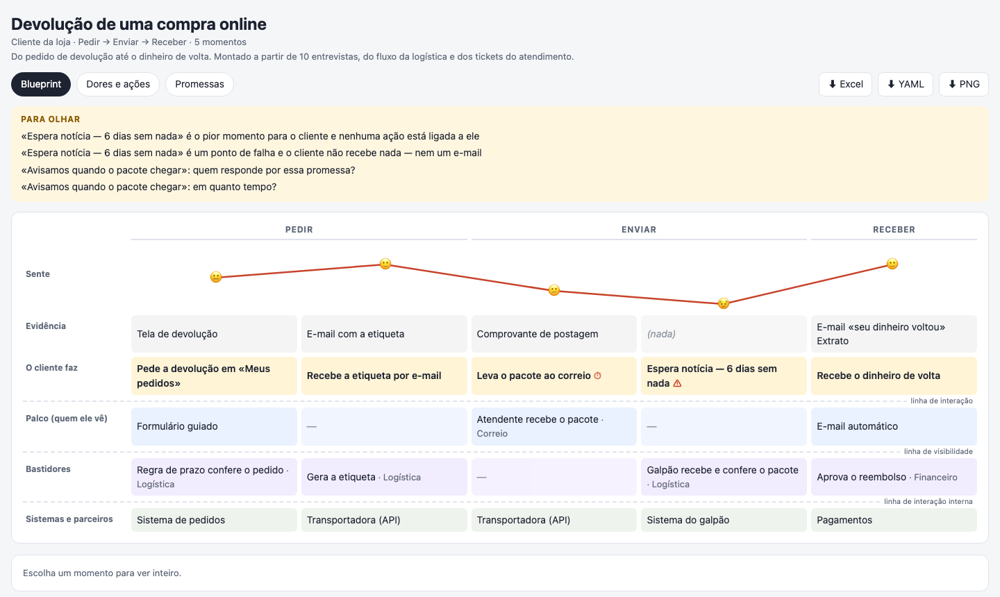
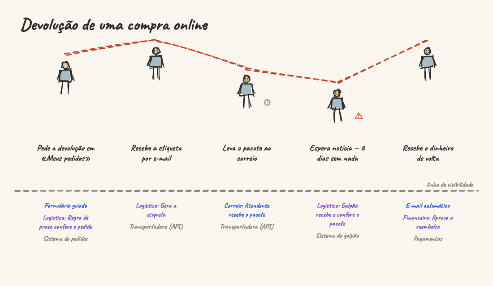

<h1 align="center">front-of-house</h1>

<p align="center"><b>Give Claude your interviews, tickets and process notes. Get a service blueprint — what the customer lives at each moment, and who makes it happen behind.</b></p>

<p align="center">
  
</p>

<p align="center">
  An <a href="https://agentskills.io">Agent Skill</a> for Claude Code, claude.ai, the Claude API and other tools that load skills.<br>
  <a href="https://ruinosus.github.io/front-of-house/">Open the gallery</a> to click through the maps, play the lessons and download the workbooks.
</p>

---

## What it does

When customers complain, every team says its part works. A **service blueprint** puts the whole thing on one page: each
moment the customer lives (in their words) and how it feels, what they see, and — under the line of visibility — who
makes it happen backstage and which systems hold it up. The worst moment, and whether anyone owns it, stops being a
matter of opinion.

front-of-house reads what the team already has — interviews, support tickets, survey comments, the internal flow — and
writes **one file**. It **bets, asks, and never invents**: a feeling goes in the file only when the material gives it (a
complaint tells where it hurts, not how much); a pain keeps its source; a promise needs an owner and a time. And it
points out what the team does not see from inside:

- the **worst moment with no action** tied to it;
- a **wait or failure where the customer gets nothing** — not even an email;
- a **promise with no owner, or no time**;
- a moment with **nobody behind it**; a **system behind almost every moment**; a **pain with no source**.

**For** product managers and service designers taking a journey to the room where it gets fixed, CX teams turning
research into actions with owners, and anyone who keeps hearing «on our side it works».

## What you get

| | |
|---|---|
| **The file** (`.blueprint.yaml`) | The source, plain text in Git; everything else is made from it. A mistake says its line. |
| **The map** (`.html`) | One page that opens offline: the phases, the line of how the customer feels, the five layers with the three lines (interaction, visibility, internal), ⚠ failure points and ⏱ waits. A moment opens its detail; tabs for pains and actions, and promises; download the workbook, the file or a PNG. |
| **The workbook** (`.xlsx`) | Summary, Blueprint, Pains and actions, Promises, Systems — for the meeting and the follow-up. |
| **The lesson** (`.lesson.html`) | The journey walked by drawing it, moment by moment, the customer higher when they feel better — made with [chalk-talk](https://github.com/ruinosus/chalk-talk). |

<p align="center"></p>

## How a conversation goes

A real run, from the evals (translated from Portuguese and shortened). The notes: six patients book by WhatsApp; the
front desk answers within two hours, sometimes the next day — four complained; an SMS confirms the day before; on the
day, checking the health-plan card takes long.

> **You:** blueprint our clinic's appointment booking from these notes
>
> **Claude:** The draft is in `agendamento.blueprint.yaml` — 6 moments in 3 phases. **The worst moment is waiting for
> the WhatsApp reply**: 4 of 6 patients complained, and while they wait they get nothing — not even a «message
> received». The scheduling system is behind 5 of 6 moments. I left out what the notes do not say: the feeling scores,
> a promised time, the actions.
>
> 1. **«Within 2 hours»** — is it a promise to patients, or just what usually happens? My bet: no formal promise.
> 2. **How does waiting for the reply feel, 1 to 5?** I'd say 2 — four of six complained — but nobody gave a score.
> 3. **Who owns the reply time?** I'd bet on the front-desk coordinator — only a guess.
> 4. …
> 5. **The card check** — the health plan's portal, or a phone call? I bet on the portal; it says where the delay comes from.
> 6. **What to change first at the worst moment?** My bet: an instant automatic reply on WhatsApp.

## Install

**Claude Code**:

```
/plugin marketplace add ruinosus/front-of-house
/plugin install front-of-house@front-of-house
```

Or copy `skills/front-of-house` to `~/.claude/skills/`. **claude.ai**: upload `front-of-house.zip` from the
[latest release](https://github.com/ruinosus/front-of-house/releases) in Settings › Capabilities › Skills (code
execution on). **Claude API**: the same zip with the Skills API. **Other tools**: copy `skills/front-of-house` where the
tool reads skills; it needs Node.js 18 or later.

**Without a skill** — on npm as `front-of-house`:

```
npx front-of-house returns.blueprint.yaml --check
npx front-of-house returns.blueprint.yaml --all --lang pt     # map, workbook and lesson
```

The format is [`references/format.md`](skills/front-of-house/references/format.md); two blueprints are in
[`skills/front-of-house/examples/`](skills/front-of-house/examples) — the return one has, on purpose, four things to
look at.

## Develop

`tools/` builds the generated files from `src/` and the pieces of the way engine it reuses (`tools/sources.json`, see
`sources.example.json`):

```
cd tools && npm install
npm run assets   # scripts/engine.mjs, assets/map.html, assets/lesson.html
npm run check    # the engine's checks, every example built (and what each must look at), a broken file, the map in Chrome
npm run site     # docs/: the gallery
npm run zip      # dist/front-of-house.zip
```

## License

MIT. Lessons by [chalk-talk](https://github.com/ruinosus/chalk-talk) (MIT; Rough.js MIT; Caveat and Shantell Sans, SIL
Open Font License). Its sibling [stage-door](https://github.com/ruinosus/stage-door) maps how the work goes inside.
