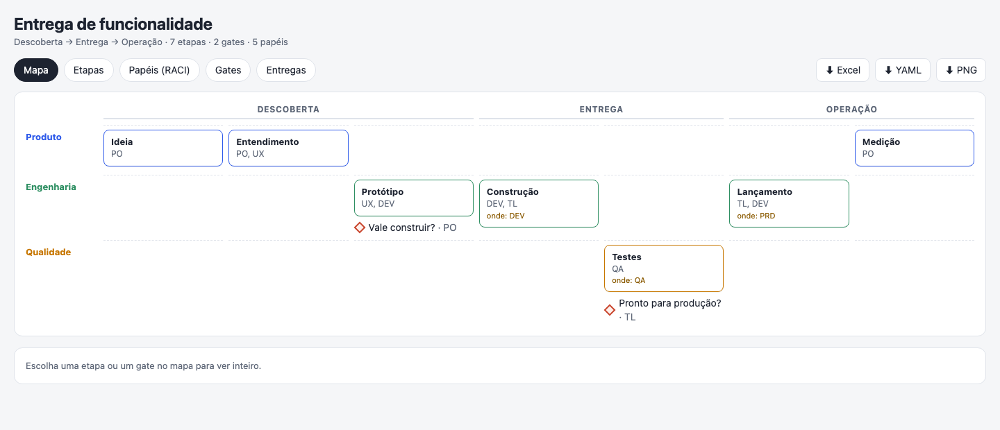
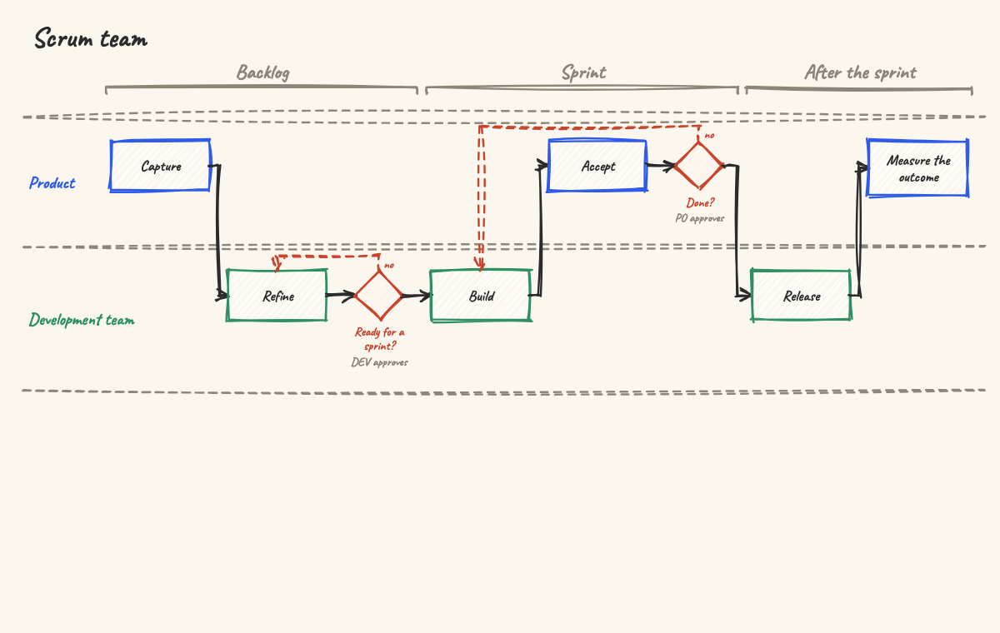
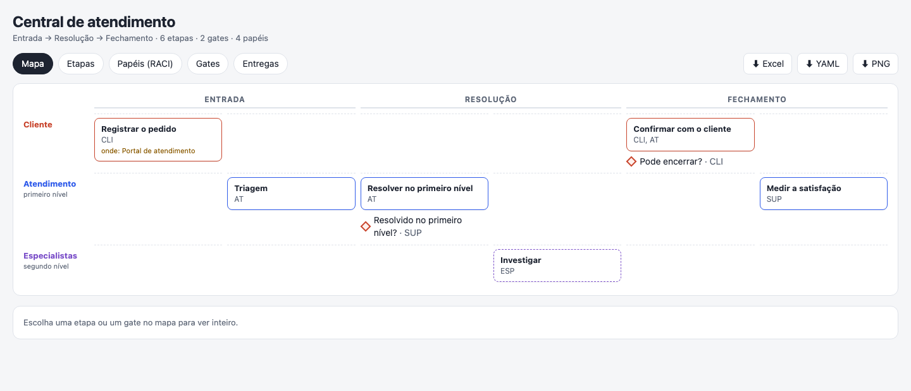

<h1 align="center">stage-door</h1>

<p align="center"><b>Give Claude your team's process — the PDF, the slides, what everyone just knows — and get one clear, checkable way of working.</b></p>

<p align="center">
  
</p>

<p align="center">
  An <a href="https://agentskills.io">Agent Skill</a> for Claude Code, claude.ai, the Claude API and other tools that load skills.<br>
  <a href="https://ruinosus.github.io/stage-door/">Open the gallery</a> to click through the maps, play the lessons and download the workbooks.
</p>

---

## What it does

Most teams' way of working lives in a 30-page PDF, a few slides and the head of whoever has been there longest. Ask
"who approves the release?" and you get three answers. stage-door reads what exists and writes it down as **one file**:

- the **stages** the work goes through, in order, each with its key question and what it delivers;
- the **phases** (milestones), and **who leads** each stage;
- the **gates** — who approves, what must be ready, where the work goes back when it does not pass;
- the **roles** and who takes part where (the RACI comes from it);
- **what each stage receives and from where** — an output of an earlier stage or gate, or something from outside — and
  its **metrics**; what **comes out of each gate** (the decision, what was approved);
- the **number** that says it worked, when there is one.

It **bets, asks, and never invents**: what the material implies becomes a bet you confirm; what it does not say becomes
a question — all of them in one message. It also sorts out the usual mix-ups on its own: an activity written as a stage,
a daily or a planning in the flow, DEV/QA/PRD used as phases, a person's name where a role should be.

**For** whoever leads a team (get the process out of the PDF), whoever joins it (a map or a lesson instead of 30 pages),
whoever decides at the gates (the checklist in hand), and whoever designs processes for others.

## What you get

From the one `<id>.way.yaml`:

| | |
|---|---|
| **The file** (`.way.yaml`) | The source. Plain text you keep in Git; everything else is made from it. A mistake says its line. |
| **The map** (`.html`) | One page that opens offline: phases on top, who leads in the rows, stages in order, gates under the stage they close. Click a stage or a gate for its detail — where each input comes from, who receives each output. A **Stages** tab with the table teams know (comes in, delivers, roles, metrics; the gate as a row); tabs for Roles (RACI), Gates and Outputs; download the workbook, the file or a PNG. «To look at» says what does not hold. |
| **The workbook** (`.xlsx`) | Summary, Stages (with where each input comes from, and metrics), Gates (with what comes out), Roles (RACI), Outputs, KPIs, a **Gate checklist** for the meeting and the **Thread** — who delivers each output and who receives it. Header frozen, filters on, lanes in colour. Opens in Excel, Numbers and LibreOffice. |
| **The lesson** (`.lesson.html`) | The flow drawn stroke by stroke, a chapter per phase, each gate with who approves it and its way back — made with [chalk-talk](https://github.com/ruinosus/chalk-talk). |

<table>
  <tr>
    <td width="50%"></td>
    <td width="50%"></td>
  </tr>
  <tr>
    <td>The lesson of a Scrum team: Definition of Ready and Done as gates, and where each sends the work back.</td>
    <td>A service desk (in Portuguese): solved at first level, or escalated to a specialist.</td>
  </tr>
</table>

### And back

Someone edits the workbook — renames a stage, changes who approves a gate, adds a row. Give it back to Claude: it lists
each change, one by one, flags the ones that remove something or change a gate, and writes into the `.way.yaml` only
the ones you take.

## How a conversation goes

A real run in Claude Code, from a fictional editorial team's process document (translated from Portuguese and
shortened):

> **You:** turn processo-editorial.md into our way of working. Save it as editorial.way.yaml.
>
> **Claude:** The draft is in `editorial.way.yaml` and passes the format: 7 stages, 3 gates, 4 phases, 4 lanes. What I
> already sorted out:
> - The **weekly pitch meeting** is out of the flow — it is a meeting, not a place the content goes through. Its
>   decision became the gate **"Pitch approved?"**, approved by the Editor-in-chief.
> - **Marina Okada** is not a role: the role is Editor-in-chief; her name only appears beside the lane.
> - **Proofreading** and **fact-checking** became required activities of Review; "back to Writing" became the gate
>   **"Facts right?"**, approved by the Reviewer.
>
> 1. **Who approves "Ready to publish?"** The document only says "someone checks text and art together". My bet is
>    the **Section editor**, who schedules and publishes.
> 2. …
> 3. **Is "Staging" a real phase?** The document defines it by the CMS preview environment…
> 4. **Should I add "Share on social media" after publishing?** The Social media role takes part in nothing today.
> 5. **Which audience number says it worked?** The document only says "we track audience", and I won't make it up.
> 6. **When a pitch is rejected, what happens to it?** My bet: it is archived.
>
> **You:** 1 yes. 2 yes. 3 merge it with Publishing, Staging is not a phase. 4 yes. 5 skip, no target yet. 6 archived.
> Go ahead and make everything.
>
> **Claude:** Done — the map, the workbook and the lesson. Still open: no stage measures the result (you skipped the
> target), and the document does not say where "Ready to publish?" sends the work back, so I left it blank.

## Install

**Claude Code**:

```
/plugin marketplace add ruinosus/stage-door
/plugin install stage-door@stage-door
```

Or copy `skills/stage-door` to `~/.claude/skills/`.

**claude.ai**: download `stage-door.zip` from the [latest release](https://github.com/ruinosus/stage-door/releases),
then Settings › Capabilities › Skills › Upload. Code execution must be on.

**Claude API**: upload the same zip with the Skills API (`/v1/skills`) and use it with the code execution tool.

**Other tools** (Codex, GitHub Copilot, Cursor, Gemini CLI…): copy `skills/stage-door` to the folder where the tool
reads skills. The tool needs Node.js 18 or later.

**Without a skill** — on npm as `stage-door`:

```
npx stage-door team.way.yaml --all                    # map, workbook and lesson beside the file
npx stage-door team.way.yaml --from edited.xlsx       # what the edited workbook changes
npx stage-door team.way.yaml --from edited.xlsx --take all
```

## The file

```yaml
format: stage-door/v1
name: Scrum team
lanes:
  - { id: product, name: Product, color: prod }
  - { id: team, name: Development team, color: tech }
roles:
  - { id: po, acronym: PO, name: Product Owner, lane: product }
  - { id: dev, acronym: DEV, name: Developers, lane: team }
phases:
  - { id: backlog, name: Backlog }
  - { id: sprint, name: Sprint }
stages:
  - id: refine
    name: Refine
    phase: backlog
    lane: team
    roles: [dev, po]
    question: Do we understand it well enough to size it?
    inputs:
      - from: item                       # an output of an earlier stage, by its id
    outputs:
      - { id: criteria, name: Acceptance criteria }
    metrics: ["% of items ready before planning"]
  # …
gates:
  - id: ready
    after: refine
    name: Ready for a sprint?
    approver: dev
    criteria: [{ kind: outputs, outputs: [criteria] }]
    on_fail: refine
    outputs:                             # what comes out of the gate
      - { id: ready-item, name: Item ready for a sprint }
```

The whole format is [`references/format.schema.json`](skills/stage-door/references/format.schema.json); three complete
examples are in [`skills/stage-door/examples/`](skills/stage-door/examples) — four, one of them
([`initiative-portfolio`](skills/stage-door/examples/initiative-portfolio.way.yaml)) with the whole thread.

## What is inside

```
skills/stage-door/
  SKILL.md                  what Claude follows: read, draft, check, ask once, make, and the way back
  references/               the format, what the words mean, what the check points out, how to ask
  examples/                 four fictional ways of working (feature delivery, Scrum, service desk, initiative portfolio)
  scripts/build.mjs         checks a .way.yaml and makes the map, the workbook and the lesson; reads a workbook back
  scripts/engine.mjs        the rules (generated)
  assets/map.html           the map page (generated)
  assets/lesson.html        the lesson page — chalk-talk's player (generated)
```

Node.js 18 or later and nothing else. Chrome, Chromium or Edge, when installed, checks the lesson's drawing.

## Not yet

It maps how the work **should** go. It does not track items moving through the stages, nor decide a gate.

## Develop

`tools/` builds the generated files from the way engine and chalk-talk (`tools/sources.json`, see
`sources.example.json`), checks the examples end to end and makes the gallery:

```
cd tools && npm install
npm run assets   # scripts/engine.mjs, assets/map.html, assets/lesson.html
npm run check    # every example: map, workbook (and back), lesson; a broken file says its line
npm run site     # docs/: the gallery
npm run zip      # dist/stage-door.zip
claude plugin eval .. --ablation none --allow-tools Bash Write Edit   # the evals in evals/
```

## License

MIT. The lesson's player is [chalk-talk](https://github.com/ruinosus/chalk-talk) (MIT; Rough.js MIT; Caveat and Shantell
Sans, SIL Open Font License).
