# RH — autoatendimento do colaborador: o que o agent-review leu

> Estes diagramas têm dados do cliente: deixe este arquivo no ambiente dele.

6 agentes (1 orquestrador, 5 especialistas) · 38 padrões · 3 fora do padrão · 4 só um tem

## Para olhar

### Contradições · 2

- rh-folha: «handoff da folha, seção 4» diz que tem «Escalonamento para humano», mas o YAML não tem
- rh-beneficios tem «Só o conhecimento», mas também «Conhecimento geral do modelo ligado» (regra «Quem pede só o conhecimento tem o conhecimento geral desligado»)

### Contrato e telemetria · 6

- rh-admissao registra «rh_admissao_onerror»; os outros, «‹nome›_OnError»: é o mesmo evento?
- O orquestrador chama «RH - Mobilidade», que não está na pasta
- A descrição de roteamento de rh-admissao tem só 9 caracteres
- O fluxo «Abrir caso no Workday» de rh-admissao não devolve nada
- O evento «RhFolha_OnError» de rh-folha não disparou em 30 dias
- rh-facilities não tem nenhuma linha na telemetria: está ligado ao Application Insights?

### Fora do padrão · 10

- 1 especialista registra «‹nome›_OnError» sem «ConversationId» (rh-admissao): é intencional?
- 1 especialista não registra telemetria (rh-facilities): é intencional?
- 1 especialista não tem «Sem emojis» (rh-facilities): é intencional?
- 1 especialista não recebe o histórico da conversa do orquestrador (rh-folha): é intencional?
- 1 especialista não recebe «CategoriaSolicitacao» do orquestrador (rh-folha): é intencional?
- 1 especialista tem uma variação do bloco oficial «Formatação de links» (rh-folha): alinhar?
- 1 especialista não escala para humano (rh-folha), e o padrão foi aceito: corrigir?
- 4 especialistas definem «Tamanho da resposta» de 2 jeitos (3 bullets em 3; 5 frases em 2): unificar?
- rh-facilities define «Tamanho da resposta» duas vezes (3 bullets; 5 frases): qual vale?
- O tipo «triagem» tem 1 especialista (rh-folha): nada a comparar dentro dele

### Regras · 1

- Regra «Todo especialista tem KPI»: 1 especialista não cumpre (rh-facilities)

### Só um tem · 4

- Só rh-admissao tem «Conector SharePoint»: inovação ou dívida?
- Só rh-admissao tem «Servidor MCP RH Admissao MCP»: inovação ou dívida?
- Só rh-folha tem «Desambiguação («você quis dizer…»)»: inovação ou dívida?
- Só rh-facilities tem «Condição de busca só no YAML (a tela pode apagar)»: inovação ou dívida?

### Sem uso · 4

- Ninguém chama o fluxo «Listar unidades» (rh-facilities): remover ou ligar?
- Ninguém chama o tópico «AvisoAntigo» (rh-facilities): remover ou ligar?
- rh-ferias tem um nó desligado em «topics/Escalate» (SendActivity): remover?
- Ninguém usa a variável «PreferenciaAntiga» (rh-folha): remover?

## Os diagramas

Cada diagrama também está sozinho em `rh-agents.diagrams/`, para colar onde o Mermaid for lido.

### Topologia

Quem atende o cliente e o que cada um alcança. Setas grossas são chamadas; finas, o que cada um usa (um fluxo, um sistema); tracejadas, o que ninguém chama ou não está na pasta. Em vermelho o que falta numa chamada; em âmbar, uma descrição de roteamento curta ou um fluxo que não devolve nada. Os números são os inícios de tópico na telemetria.

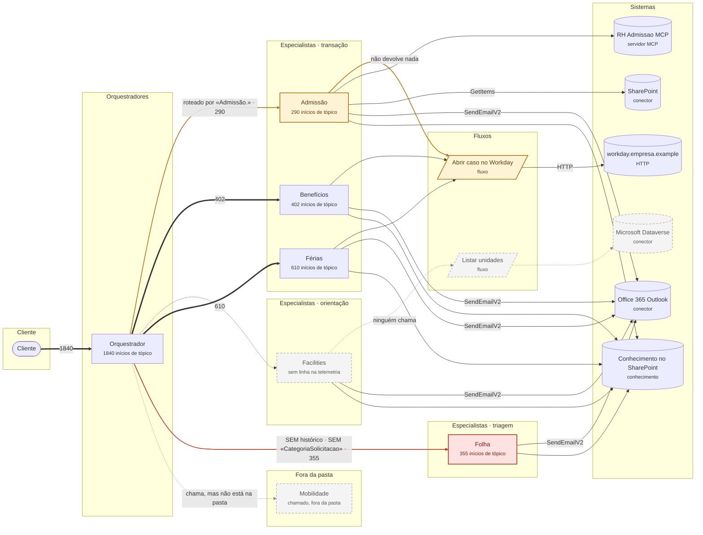

<details><summary>Como explicação (VS Code, Obsidian)</summary>

```visual-explainer-mermaid
flowchart LR
%% title Topologia
%% # Topologia
%% > Quem atende o cliente e o que cada um alcança. Setas grossas são chamadas; finas, o que cada um usa (um fluxo, um sistema); tracejadas, o que ninguém chama ou não está na pasta. Em vermelho o que falta numa chamada; em âmbar, uma descrição de roteamento curta ou um fluxo que não devolve nada. Os números são os inícios de tópico na telemetria.
  %% title Topologia · RH — autoatendimento do colaborador
  %% agent-review 2.3.0
  subgraph s3 ["Cliente"]
    n1(["Cliente"])
  end
  subgraph s6 ["Orquestradores"]
    n7["Orquestrador<br/><small>1840 inícios de tópico</small>"]
  end
  subgraph s9 ["Especialistas · transação"]
    n2["Admissão<br/><small>290 inícios de tópico</small>"]
    n3["Benefícios<br/><small>402 inícios de tópico</small>"]
    n4["Férias<br/><small>610 inícios de tópico</small>"]
  end
  subgraph s14 ["Especialistas · orientação"]
    n5["Facilities<br/><small>sem linha na telemetria</small>"]
  end
  subgraph s17 ["Especialistas · triagem"]
    n6["Folha<br/><small>355 inícios de tópico</small>"]
  end
  subgraph s20 ["Fora da pasta"]
    n8["Mobilidade<br/><small>chamado, fora da pasta</small>"]
  end
  subgraph s23 ["Fluxos"]
    n9[/"Abrir caso no Workday<br/><small>fluxo</small>"/]
    n10[/"Listar unidades<br/><small>fluxo</small>"/]
  end
  subgraph s27 ["Sistemas"]
    n11[("workday.empresa.example<br/><small>HTTP</small>")]
    n12[("Microsoft Dataverse<br/><small>conector</small>")]
    n13[("RH Admissao MCP<br/><small>servidor MCP</small>")]
    n14[("SharePoint<br/><small>conector</small>")]
    n15[("Office 365 Outlook<br/><small>conector</small>")]
    n16[("Conhecimento no SharePoint<br/><small>conhecimento</small>")]
  end
  n1 ==>|"1840"| n7
  n7 ==>|"roteado por «Admissão.» · 290"| n2
  n7 ==>|"402"| n3
  n7 -.-> n5
  n7 ==>|"610"| n4
  n7 ==>|"SEM histórico · SEM «CategoriaSolicitacao» · 355"| n6
  n7 -.->|"chama, mas não está na pasta"| n8
  n2 -->|"não devolve nada"| n9
  n3 --> n9
  n5 -.->|"ninguém chama"| n10
  n4 --> n9
  n9 -->|"HTTP"| n11
  n10 -.-> n12
  n2 --> n13
  n2 -->|"GetItems"| n14
  n2 -->|"SendEmailV2"| n15
  n2 --> n16
  n3 -->|"SendEmailV2"| n15
  n3 --> n16
  n5 -->|"SendEmailV2"| n15
  n5 --> n16
  n4 -->|"SendEmailV2"| n15
  n4 --> n16
  n6 -->|"SendEmailV2"| n15
  n6 --> n16
  linkStyle 1 stroke:#b7791f,stroke-width:2px
  linkStyle 5 stroke:#c0392b,stroke-width:2px
  linkStyle 6 stroke:#888
  linkStyle 7 stroke:#b7791f,stroke-width:2px
  linkStyle 9 stroke:#888
  linkStyle 12 stroke:#888
  classDef bad fill:#fde2e1,stroke:#c0392b,color:#7b1d16,stroke-width:2px
  classDef amber fill:#fff3d6,stroke:#b7791f,color:#5c3d0b,stroke-width:2px
  classDef ok fill:#e3f4e8,stroke:#2f855a,color:#1c4532
  classDef ghost fill:#f4f4f4,stroke:#888,color:#555,stroke-dasharray:5 4
  classDef muted fill:#f4f4f4,stroke:#bbb,color:#666
  class n5,n8,n10,n12 ghost
  class n6 bad
  class n2,n9 amber
```

</details>

### A chamada para Admissão

O que acontece, passo a passo, quando o orquestrador encaminha para Admissão. ⚠ marca o que olhar.

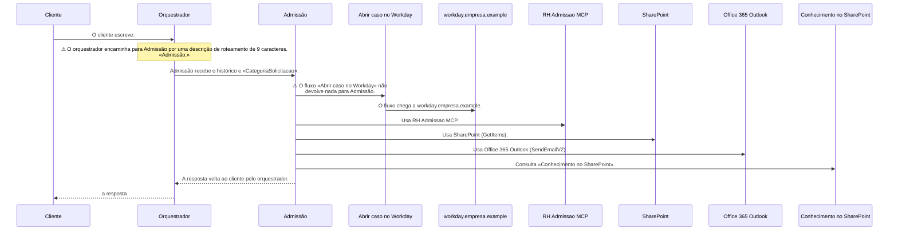

<details><summary>Como explicação (VS Code, Obsidian)</summary>

```visual-explainer-mermaid
%%{init: {"sequence": {"wrap": true, "width": 220}}}%%
%% title A chamada para Admissão
%% # A chamada para Admissão
%% > O que acontece, passo a passo, quando o orquestrador encaminha para Admissão. ⚠ marca o que olhar.
sequenceDiagram
  %% title A chamada para Admissão
  %% agent-review 2.3.0
  participant p1 as Cliente
  participant p2 as Orquestrador
  participant p3 as Admissão
  participant p4 as Abrir caso no Workday
  participant p5 as workday.empresa.example
  participant p6 as RH Admissao MCP
  participant p7 as SharePoint
  participant p8 as Office 365 Outlook
  participant p9 as Conhecimento no SharePoint
  %% # Cliente
  %% > O cliente escreve.
  p1->>p2: O cliente escreve.
  %% # Orquestrador
  %% > O orquestrador encaminha para Admissão por uma descrição de roteamento de 9 caracteres.
  Note over p2: ⚠ O orquestrador encaminha para Admissão por uma descrição de roteamento de 9 caracteres.<br/>«Admissão.»
  %% # Admissão
  %% > Admissão recebe o histórico e «CategoriaSolicitacao».
  p2->>p3: Admissão recebe o histórico e «CategoriaSolicitacao».
  %% # Abrir caso no Workday
  %% > O fluxo «Abrir caso no Workday» não devolve nada para Admissão.
  p3->>p4: ⚠ O fluxo «Abrir caso no Workday» não devolve nada para Admissão.
  %% # workday.empresa.example
  %% > O fluxo chega a workday.empresa.example.
  p4->>p5: O fluxo chega a workday.empresa.example.
  %% # RH Admissao MCP
  %% > Usa RH Admissao MCP.
  p3->>p6: Usa RH Admissao MCP.
  %% # SharePoint
  %% > Usa SharePoint (GetItems).
  p3->>p7: Usa SharePoint (GetItems).
  %% # Office 365 Outlook
  %% > Usa Office 365 Outlook (SendEmailV2).
  p3->>p8: Usa Office 365 Outlook (SendEmailV2).
  %% # Conhecimento no SharePoint
  %% > Consulta «Conhecimento no SharePoint».
  p3->>p9: Consulta «Conhecimento no SharePoint».
  %% # Orquestrador
  %% > A resposta volta ao cliente pelo orquestrador.
  p3-->>p2: A resposta volta ao cliente pelo orquestrador.
  p2-->>p1: a resposta
```

</details>

### A chamada para Benefícios

O que acontece, passo a passo, quando o orquestrador encaminha para Benefícios. ⚠ marca o que olhar.

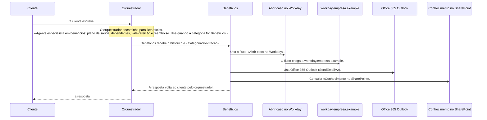

<details><summary>Como explicação (VS Code, Obsidian)</summary>

```visual-explainer-mermaid
%%{init: {"sequence": {"wrap": true, "width": 220}}}%%
%% title A chamada para Benefícios
%% # A chamada para Benefícios
%% > O que acontece, passo a passo, quando o orquestrador encaminha para Benefícios. ⚠ marca o que olhar.
sequenceDiagram
  %% title A chamada para Benefícios
  %% agent-review 2.3.0
  participant p1 as Cliente
  participant p2 as Orquestrador
  participant p3 as Benefícios
  participant p4 as Abrir caso no Workday
  participant p5 as workday.empresa.example
  participant p6 as Office 365 Outlook
  participant p7 as Conhecimento no SharePoint
  %% # Cliente
  %% > O cliente escreve.
  p1->>p2: O cliente escreve.
  %% # Orquestrador
  %% > O orquestrador encaminha para Benefícios.
  Note over p2: O orquestrador encaminha para Benefícios.<br/>«Agente especialista em benefícios: plano de saúde, dependentes, vale-refeição e reembolso. Use quando a categoria for Beneficios.»
  %% # Benefícios
  %% > Benefícios recebe o histórico e «CategoriaSolicitacao».
  p2->>p3: Benefícios recebe o histórico e «CategoriaSolicitacao».
  %% # Abrir caso no Workday
  %% > Usa o fluxo «Abrir caso no Workday».
  p3->>p4: Usa o fluxo «Abrir caso no Workday».
  %% # workday.empresa.example
  %% > O fluxo chega a workday.empresa.example.
  p4->>p5: O fluxo chega a workday.empresa.example.
  %% # Office 365 Outlook
  %% > Usa Office 365 Outlook (SendEmailV2).
  p3->>p6: Usa Office 365 Outlook (SendEmailV2).
  %% # Conhecimento no SharePoint
  %% > Consulta «Conhecimento no SharePoint».
  p3->>p7: Consulta «Conhecimento no SharePoint».
  %% # Orquestrador
  %% > A resposta volta ao cliente pelo orquestrador.
  p3-->>p2: A resposta volta ao cliente pelo orquestrador.
  p2-->>p1: a resposta
```

</details>

### A chamada para Facilities

O que acontece, passo a passo, quando o orquestrador encaminha para Facilities. ⚠ marca o que olhar.

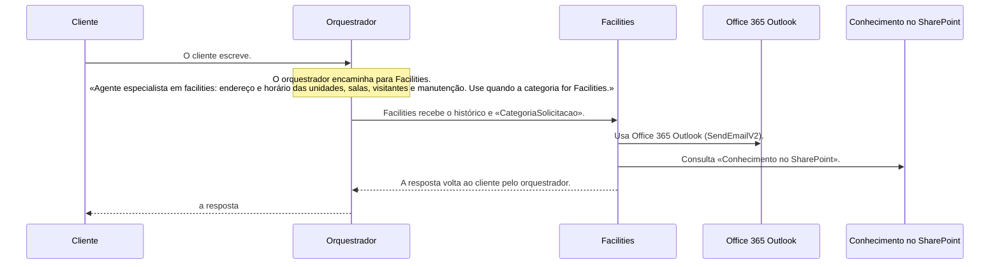

<details><summary>Como explicação (VS Code, Obsidian)</summary>

```visual-explainer-mermaid
%%{init: {"sequence": {"wrap": true, "width": 220}}}%%
%% title A chamada para Facilities
%% # A chamada para Facilities
%% > O que acontece, passo a passo, quando o orquestrador encaminha para Facilities. ⚠ marca o que olhar.
sequenceDiagram
  %% title A chamada para Facilities
  %% agent-review 2.3.0
  participant p1 as Cliente
  participant p2 as Orquestrador
  participant p3 as Facilities
  participant p4 as Office 365 Outlook
  participant p5 as Conhecimento no SharePoint
  %% # Cliente
  %% > O cliente escreve.
  p1->>p2: O cliente escreve.
  %% # Orquestrador
  %% > O orquestrador encaminha para Facilities.
  Note over p2: O orquestrador encaminha para Facilities.<br/>«Agente especialista em facilities: endereço e horário das unidades, salas, visitantes e manutenção. Use quando a categoria for Facilities.»
  %% # Facilities
  %% > Facilities recebe o histórico e «CategoriaSolicitacao».
  p2->>p3: Facilities recebe o histórico e «CategoriaSolicitacao».
  %% # Office 365 Outlook
  %% > Usa Office 365 Outlook (SendEmailV2).
  p3->>p4: Usa Office 365 Outlook (SendEmailV2).
  %% # Conhecimento no SharePoint
  %% > Consulta «Conhecimento no SharePoint».
  p3->>p5: Consulta «Conhecimento no SharePoint».
  %% # Orquestrador
  %% > A resposta volta ao cliente pelo orquestrador.
  p3-->>p2: A resposta volta ao cliente pelo orquestrador.
  p2-->>p1: a resposta
```

</details>

### A chamada para Férias

O que acontece, passo a passo, quando o orquestrador encaminha para Férias. ⚠ marca o que olhar.

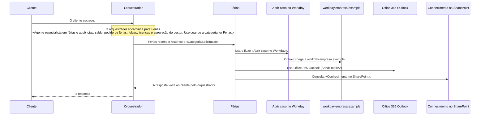

<details><summary>Como explicação (VS Code, Obsidian)</summary>

```visual-explainer-mermaid
%%{init: {"sequence": {"wrap": true, "width": 220}}}%%
%% title A chamada para Férias
%% # A chamada para Férias
%% > O que acontece, passo a passo, quando o orquestrador encaminha para Férias. ⚠ marca o que olhar.
sequenceDiagram
  %% title A chamada para Férias
  %% agent-review 2.3.0
  participant p1 as Cliente
  participant p2 as Orquestrador
  participant p3 as Férias
  participant p4 as Abrir caso no Workday
  participant p5 as workday.empresa.example
  participant p6 as Office 365 Outlook
  participant p7 as Conhecimento no SharePoint
  %% # Cliente
  %% > O cliente escreve.
  p1->>p2: O cliente escreve.
  %% # Orquestrador
  %% > O orquestrador encaminha para Férias.
  Note over p2: O orquestrador encaminha para Férias.<br/>«Agente especialista em férias e ausências: saldo, pedido de férias, folgas, licenças e aprovação do gestor. Use quando a categoria for Ferias.»
  %% # Férias
  %% > Férias recebe o histórico e «CategoriaSolicitacao».
  p2->>p3: Férias recebe o histórico e «CategoriaSolicitacao».
  %% # Abrir caso no Workday
  %% > Usa o fluxo «Abrir caso no Workday».
  p3->>p4: Usa o fluxo «Abrir caso no Workday».
  %% # workday.empresa.example
  %% > O fluxo chega a workday.empresa.example.
  p4->>p5: O fluxo chega a workday.empresa.example.
  %% # Office 365 Outlook
  %% > Usa Office 365 Outlook (SendEmailV2).
  p3->>p6: Usa Office 365 Outlook (SendEmailV2).
  %% # Conhecimento no SharePoint
  %% > Consulta «Conhecimento no SharePoint».
  p3->>p7: Consulta «Conhecimento no SharePoint».
  %% # Orquestrador
  %% > A resposta volta ao cliente pelo orquestrador.
  p3-->>p2: A resposta volta ao cliente pelo orquestrador.
  p2-->>p1: a resposta
```

</details>

### A chamada para Folha

O que acontece, passo a passo, quando o orquestrador encaminha para Folha. ⚠ marca o que olhar.

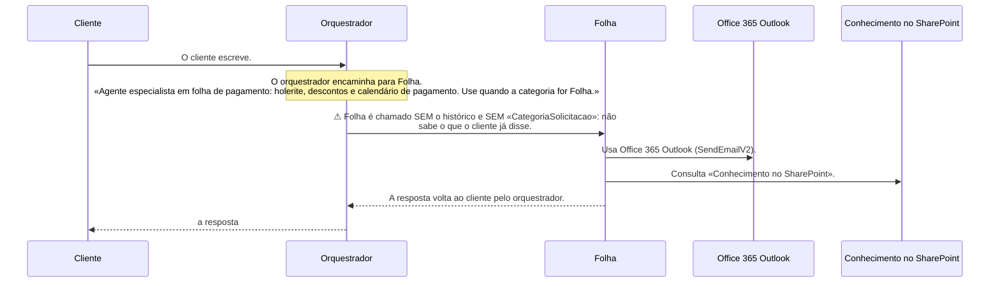

<details><summary>Como explicação (VS Code, Obsidian)</summary>

```visual-explainer-mermaid
%%{init: {"sequence": {"wrap": true, "width": 220}}}%%
%% title A chamada para Folha
%% # A chamada para Folha
%% > O que acontece, passo a passo, quando o orquestrador encaminha para Folha. ⚠ marca o que olhar.
sequenceDiagram
  %% title A chamada para Folha
  %% agent-review 2.3.0
  participant p1 as Cliente
  participant p2 as Orquestrador
  participant p3 as Folha
  participant p4 as Office 365 Outlook
  participant p5 as Conhecimento no SharePoint
  %% # Cliente
  %% > O cliente escreve.
  p1->>p2: O cliente escreve.
  %% # Orquestrador
  %% > O orquestrador encaminha para Folha.
  Note over p2: O orquestrador encaminha para Folha.<br/>«Agente especialista em folha de pagamento: holerite, descontos e calendário de pagamento. Use quando a categoria for Folha.»
  %% # Folha
  %% > Folha é chamado SEM o histórico e SEM «CategoriaSolicitacao»: não sabe o que o cliente já disse.
  p2->>p3: ⚠ Folha é chamado SEM o histórico e SEM «CategoriaSolicitacao»: não sabe o que o cliente já disse.
  %% # Office 365 Outlook
  %% > Usa Office 365 Outlook (SendEmailV2).
  p3->>p4: Usa Office 365 Outlook (SendEmailV2).
  %% # Conhecimento no SharePoint
  %% > Consulta «Conhecimento no SharePoint».
  p3->>p5: Consulta «Conhecimento no SharePoint».
  %% # Orquestrador
  %% > A resposta volta ao cliente pelo orquestrador.
  p3-->>p2: A resposta volta ao cliente pelo orquestrador.
  p2-->>p1: a resposta
```

</details>

### A chamada para Mobilidade

O que acontece, passo a passo, quando o orquestrador encaminha para Mobilidade. ⚠ marca o que olhar.

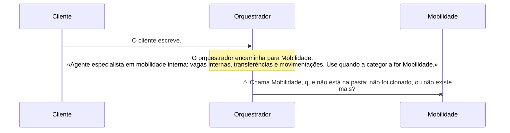

<details><summary>Como explicação (VS Code, Obsidian)</summary>

```visual-explainer-mermaid
%%{init: {"sequence": {"wrap": true, "width": 220}}}%%
%% title A chamada para Mobilidade
%% # A chamada para Mobilidade
%% > O que acontece, passo a passo, quando o orquestrador encaminha para Mobilidade. ⚠ marca o que olhar.
sequenceDiagram
  %% title A chamada para Mobilidade
  %% agent-review 2.3.0
  participant p1 as Cliente
  participant p2 as Orquestrador
  participant p3 as Mobilidade
  %% # Cliente
  %% > O cliente escreve.
  p1->>p2: O cliente escreve.
  %% # Orquestrador
  %% > O orquestrador encaminha para Mobilidade.
  Note over p2: O orquestrador encaminha para Mobilidade.<br/>«Agente especialista em mobilidade interna: vagas internas, transferências e movimentações. Use quando a categoria for Mobilidade.»
  %% # Mobilidade
  %% > Chama Mobilidade, que não está na pasta: não foi clonado, ou não existe mais?
  p2-xp3: ⚠ Chama Mobilidade, que não está na pasta: não foi clonado, ou não existe mais?
```

</details>

### Lente: Escalonamento para humano

«Escalonamento para humano» — padrão de plataforma (5 de 6). Fora: Folha.

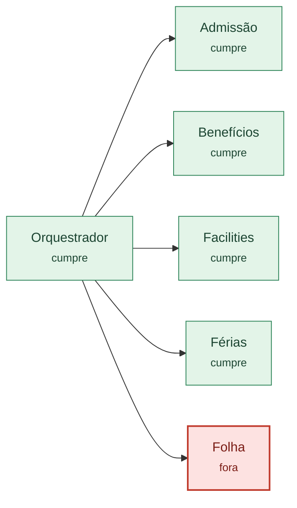

<details><summary>Como explicação (VS Code, Obsidian)</summary>

```visual-explainer-mermaid
flowchart LR
%% title Lente: Escalonamento para humano
%% # Lente: Escalonamento para humano
%% > «Escalonamento para humano» — padrão de plataforma (5 de 6). Fora: Folha.
  %% title Lente: Escalonamento para humano
  %% agent-review 2.3.0
  n1["Admissão<br/><small>cumpre</small>"]
  n2["Benefícios<br/><small>cumpre</small>"]
  n3["Férias<br/><small>cumpre</small>"]
  n4["Facilities<br/><small>cumpre</small>"]
  n5["Folha<br/><small>fora</small>"]
  n6["Orquestrador<br/><small>cumpre</small>"]
  n6 --> n1
  n6 --> n2
  n6 --> n4
  n6 --> n3
  n6 --> n5
  classDef bad fill:#fde2e1,stroke:#c0392b,color:#7b1d16,stroke-width:2px
  classDef amber fill:#fff3d6,stroke:#b7791f,color:#5c3d0b,stroke-width:2px
  classDef ok fill:#e3f4e8,stroke:#2f855a,color:#1c4532
  classDef ghost fill:#f4f4f4,stroke:#888,color:#555,stroke-dasharray:5 4
  classDef muted fill:#f4f4f4,stroke:#bbb,color:#666
  class n1,n2,n3,n4,n6 ok
  class n5 bad
```

</details>

### Lente: Registra telemetria

«Registra telemetria» — padrão de plataforma (5 de 6). Fora: Facilities.

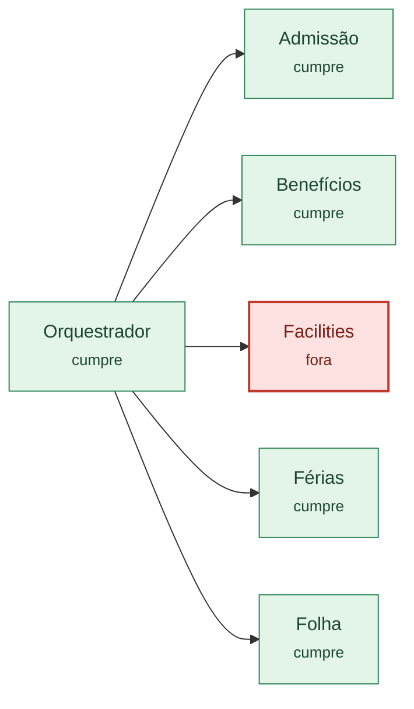

<details><summary>Como explicação (VS Code, Obsidian)</summary>

```visual-explainer-mermaid
flowchart LR
%% title Lente: Registra telemetria
%% # Lente: Registra telemetria
%% > «Registra telemetria» — padrão de plataforma (5 de 6). Fora: Facilities.
  %% title Lente: Registra telemetria
  %% agent-review 2.3.0
  n1["Admissão<br/><small>cumpre</small>"]
  n2["Benefícios<br/><small>cumpre</small>"]
  n3["Férias<br/><small>cumpre</small>"]
  n4["Facilities<br/><small>fora</small>"]
  n5["Folha<br/><small>cumpre</small>"]
  n6["Orquestrador<br/><small>cumpre</small>"]
  n6 --> n1
  n6 --> n2
  n6 --> n4
  n6 --> n3
  n6 --> n5
  classDef bad fill:#fde2e1,stroke:#c0392b,color:#7b1d16,stroke-width:2px
  classDef amber fill:#fff3d6,stroke:#b7791f,color:#5c3d0b,stroke-width:2px
  classDef ok fill:#e3f4e8,stroke:#2f855a,color:#1c4532
  classDef ghost fill:#f4f4f4,stroke:#888,color:#555,stroke-dasharray:5 4
  classDef muted fill:#f4f4f4,stroke:#bbb,color:#666
  class n1,n2,n3,n5,n6 ok
  class n4 bad
```

</details>

### Lente: Sem emojis

«Sem emojis» — padrão de plataforma (5 de 6). Fora: Facilities.


<details><summary>Como explicação (VS Code, Obsidian)</summary>

```visual-explainer-mermaid
flowchart LR
%% title Lente: Sem emojis
%% # Lente: Sem emojis
%% > «Sem emojis» — padrão de plataforma (5 de 6). Fora: Facilities.
  %% title Lente: Sem emojis
  %% agent-review 2.3.0
  n1["Admissão<br/><small>cumpre</small>"]
  n2["Benefícios<br/><small>cumpre</small>"]
  n3["Férias<br/><small>cumpre</small>"]
  n4["Facilities<br/><small>fora</small>"]
  n5["Folha<br/><small>cumpre</small>"]
  n6["Orquestrador<br/><small>cumpre</small>"]
  n6 --> n1
  n6 --> n2
  n6 --> n4
  n6 --> n3
  n6 --> n5
  classDef bad fill:#fde2e1,stroke:#c0392b,color:#7b1d16,stroke-width:2px
  classDef amber fill:#fff3d6,stroke:#b7791f,color:#5c3d0b,stroke-width:2px
  classDef ok fill:#e3f4e8,stroke:#2f855a,color:#1c4532
  classDef ghost fill:#f4f4f4,stroke:#888,color:#555,stroke-dasharray:5 4
  classDef muted fill:#f4f4f4,stroke:#bbb,color:#666
  class n1,n2,n3,n5,n6 ok
  class n4 bad
```

</details>

### Lente: Recebe o histórico da conversa

«Recebe o histórico da conversa» — padrão dos especialistas (4 de 5). Fora: Folha.

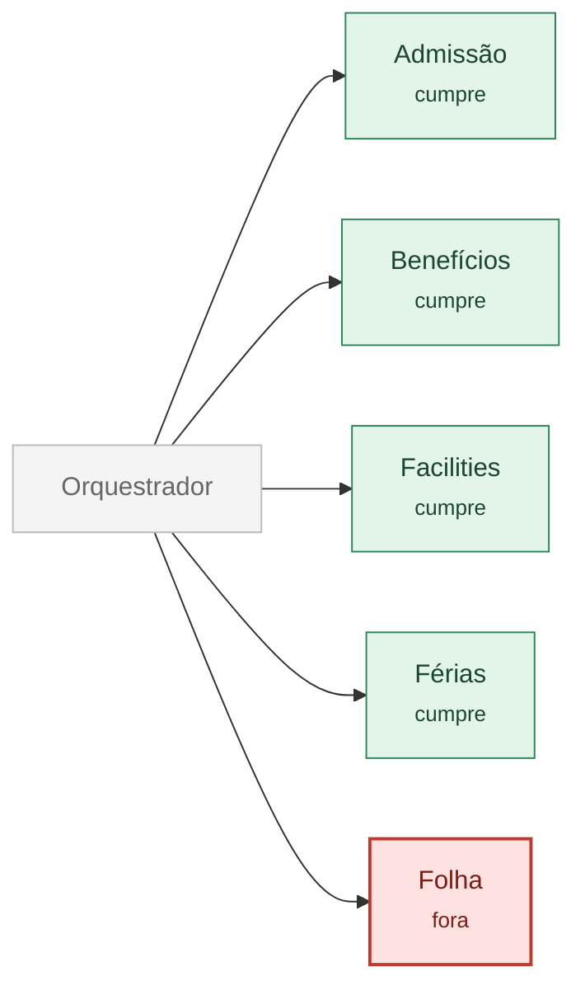

<details><summary>Como explicação (VS Code, Obsidian)</summary>

```visual-explainer-mermaid
flowchart LR
%% title Lente: Recebe o histórico da conversa
%% # Lente: Recebe o histórico da conversa
%% > «Recebe o histórico da conversa» — padrão dos especialistas (4 de 5). Fora: Folha.
  %% title Lente: Recebe o histórico da conversa
  %% agent-review 2.3.0
  n1["Admissão<br/><small>cumpre</small>"]
  n2["Benefícios<br/><small>cumpre</small>"]
  n3["Férias<br/><small>cumpre</small>"]
  n4["Facilities<br/><small>cumpre</small>"]
  n5["Folha<br/><small>fora</small>"]
  n6["Orquestrador"]
  n6 --> n1
  n6 --> n2
  n6 --> n4
  n6 --> n3
  n6 --> n5
  classDef bad fill:#fde2e1,stroke:#c0392b,color:#7b1d16,stroke-width:2px
  classDef amber fill:#fff3d6,stroke:#b7791f,color:#5c3d0b,stroke-width:2px
  classDef ok fill:#e3f4e8,stroke:#2f855a,color:#1c4532
  classDef ghost fill:#f4f4f4,stroke:#888,color:#555,stroke-dasharray:5 4
  classDef muted fill:#f4f4f4,stroke:#bbb,color:#666
  class n1,n2,n3,n4 ok
  class n5 bad
  class n6 muted
```

</details>

### Lente: Recebe «CategoriaSolicitacao» do orquestrador

«Recebe «CategoriaSolicitacao» do orquestrador» — padrão dos especialistas (4 de 5). Fora: Folha.


<details><summary>Como explicação (VS Code, Obsidian)</summary>

```visual-explainer-mermaid
flowchart LR
%% title Lente: Recebe «CategoriaSolicitacao» do orquestrador
%% # Lente: Recebe «CategoriaSolicitacao» do orquestrador
%% > «Recebe «CategoriaSolicitacao» do orquestrador» — padrão dos especialistas (4 de 5). Fora: Folha.
  %% title Lente: Recebe «CategoriaSolicitacao» do orquestrador
  %% agent-review 2.3.0
  n1["Admissão<br/><small>cumpre</small>"]
  n2["Benefícios<br/><small>cumpre</small>"]
  n3["Férias<br/><small>cumpre</small>"]
  n4["Facilities<br/><small>cumpre</small>"]
  n5["Folha<br/><small>fora</small>"]
  n6["Orquestrador"]
  n6 --> n1
  n6 --> n2
  n6 --> n4
  n6 --> n3
  n6 --> n5
  classDef bad fill:#fde2e1,stroke:#c0392b,color:#7b1d16,stroke-width:2px
  classDef amber fill:#fff3d6,stroke:#b7791f,color:#5c3d0b,stroke-width:2px
  classDef ok fill:#e3f4e8,stroke:#2f855a,color:#1c4532
  classDef ghost fill:#f4f4f4,stroke:#888,color:#555,stroke-dasharray:5 4
  classDef muted fill:#f4f4f4,stroke:#bbb,color:#666
  class n1,n2,n3,n4 ok
  class n5 bad
  class n6 muted
```

</details>

### Lente: Formatação de links

«Formatação de links» — padrão dos especialistas (4 de 5). Variação: Folha.

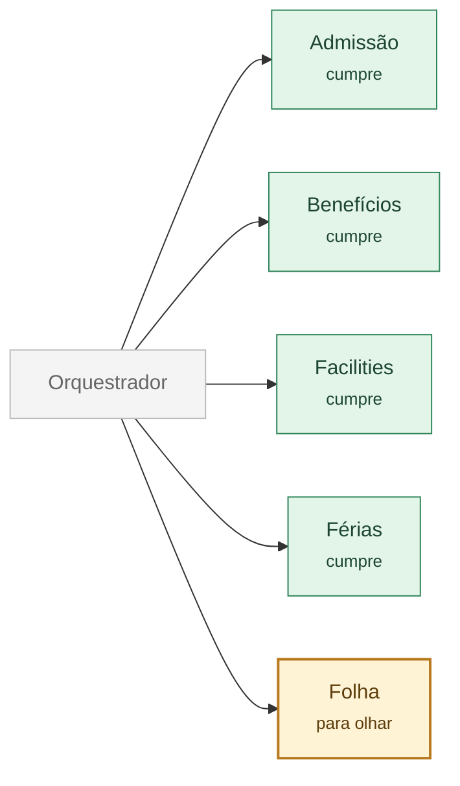

<details><summary>Como explicação (VS Code, Obsidian)</summary>

```visual-explainer-mermaid
flowchart LR
%% title Lente: Formatação de links
%% # Lente: Formatação de links
%% > «Formatação de links» — padrão dos especialistas (4 de 5). Variação: Folha.
  %% title Lente: Formatação de links
  %% agent-review 2.3.0
  n1["Admissão<br/><small>cumpre</small>"]
  n2["Benefícios<br/><small>cumpre</small>"]
  n3["Férias<br/><small>cumpre</small>"]
  n4["Facilities<br/><small>cumpre</small>"]
  n5["Folha<br/><small>para olhar</small>"]
  n6["Orquestrador"]
  n6 --> n1
  n6 --> n2
  n6 --> n4
  n6 --> n3
  n6 --> n5
  classDef bad fill:#fde2e1,stroke:#c0392b,color:#7b1d16,stroke-width:2px
  classDef amber fill:#fff3d6,stroke:#b7791f,color:#5c3d0b,stroke-width:2px
  classDef ok fill:#e3f4e8,stroke:#2f855a,color:#1c4532
  classDef ghost fill:#f4f4f4,stroke:#888,color:#555,stroke-dasharray:5 4
  classDef muted fill:#f4f4f4,stroke:#bbb,color:#666
  class n1,n2,n3,n4 ok
  class n5 amber
  class n6 muted
```

</details>

### Lente: Contrato

O que o orquestrador passa, e como encaminha: em vermelho o que falta; em âmbar, uma descrição de roteamento curta ou um fluxo que não devolve nada.

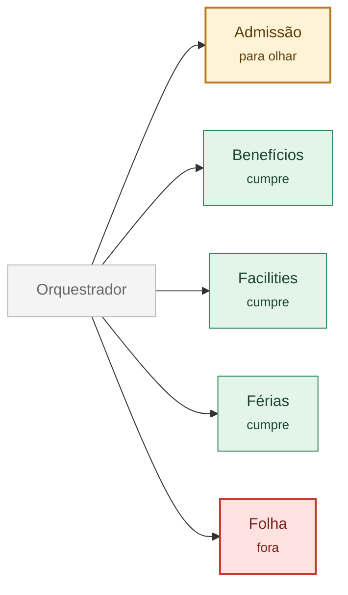

<details><summary>Como explicação (VS Code, Obsidian)</summary>

```visual-explainer-mermaid
flowchart LR
%% title Lente: Contrato
%% # Lente: Contrato
%% > O que o orquestrador passa, e como encaminha: em vermelho o que falta; em âmbar, uma descrição de roteamento curta ou um fluxo que não devolve nada.
  %% title Lente: Contrato
  %% agent-review 2.3.0
  n1["Admissão<br/><small>para olhar</small>"]
  n2["Benefícios<br/><small>cumpre</small>"]
  n3["Férias<br/><small>cumpre</small>"]
  n4["Facilities<br/><small>cumpre</small>"]
  n5["Folha<br/><small>fora</small>"]
  n6["Orquestrador"]
  n6 --> n1
  n6 --> n2
  n6 --> n4
  n6 --> n3
  n6 --> n5
  classDef bad fill:#fde2e1,stroke:#c0392b,color:#7b1d16,stroke-width:2px
  classDef amber fill:#fff3d6,stroke:#b7791f,color:#5c3d0b,stroke-width:2px
  classDef ok fill:#e3f4e8,stroke:#2f855a,color:#1c4532
  classDef ghost fill:#f4f4f4,stroke:#888,color:#555,stroke-dasharray:5 4
  classDef muted fill:#f4f4f4,stroke:#bbb,color:#666
  class n2,n3,n4 ok
  class n1 amber
  class n5 bad
  class n6 muted
```

</details>

### Lente: Telemetria

Quem registra, e o que dispara: em vermelho quem não registra ou não tem linha; em âmbar um evento escrito de outro jeito, um campo que falta ou um evento que não disparou.

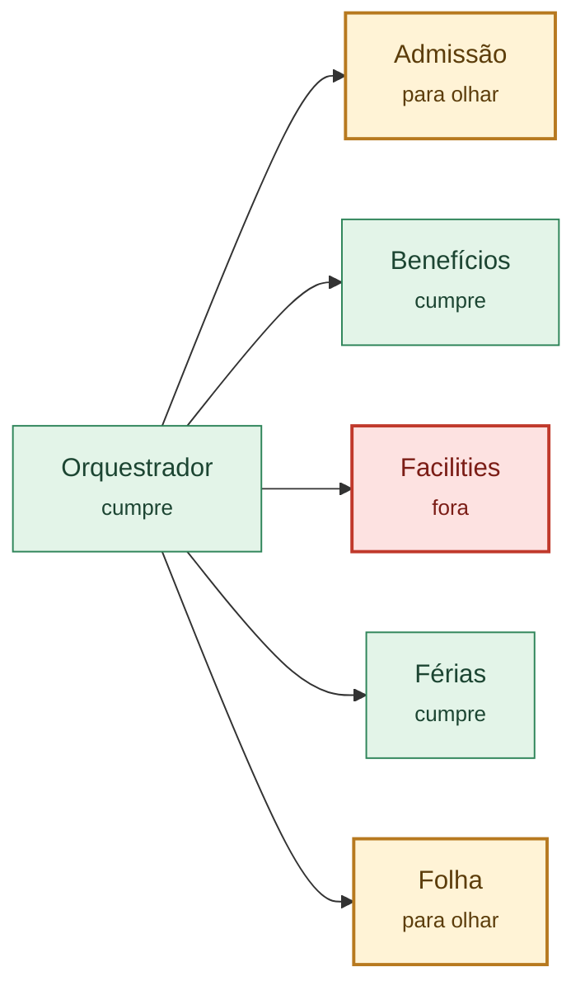

<details><summary>Como explicação (VS Code, Obsidian)</summary>

```visual-explainer-mermaid
flowchart LR
%% title Lente: Telemetria
%% # Lente: Telemetria
%% > Quem registra, e o que dispara: em vermelho quem não registra ou não tem linha; em âmbar um evento escrito de outro jeito, um campo que falta ou um evento que não disparou.
  %% title Lente: Telemetria
  %% agent-review 2.3.0
  n1["Admissão<br/><small>para olhar</small>"]
  n2["Benefícios<br/><small>cumpre</small>"]
  n3["Férias<br/><small>cumpre</small>"]
  n4["Facilities<br/><small>fora</small>"]
  n5["Folha<br/><small>para olhar</small>"]
  n6["Orquestrador<br/><small>cumpre</small>"]
  n6 --> n1
  n6 --> n2
  n6 --> n4
  n6 --> n3
  n6 --> n5
  classDef bad fill:#fde2e1,stroke:#c0392b,color:#7b1d16,stroke-width:2px
  classDef amber fill:#fff3d6,stroke:#b7791f,color:#5c3d0b,stroke-width:2px
  classDef ok fill:#e3f4e8,stroke:#2f855a,color:#1c4532
  classDef ghost fill:#f4f4f4,stroke:#888,color:#555,stroke-dasharray:5 4
  classDef muted fill:#f4f4f4,stroke:#bbb,color:#666
  class n2,n3,n6 ok
  class n1,n5 amber
  class n4 bad
```

</details>

### Lente: Sem uso

O que ninguém usa, ou está desligado: remover ou ligar?

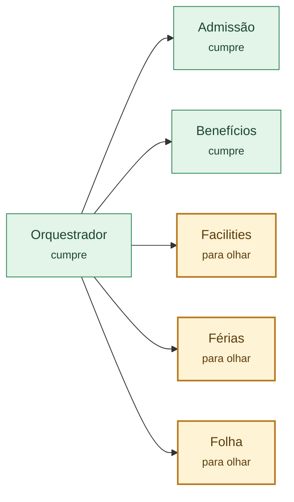

<details><summary>Como explicação (VS Code, Obsidian)</summary>

```visual-explainer-mermaid
flowchart LR
%% title Lente: Sem uso
%% # Lente: Sem uso
%% > O que ninguém usa, ou está desligado: remover ou ligar?
  %% title Lente: Sem uso
  %% agent-review 2.3.0
  n1["Admissão<br/><small>cumpre</small>"]
  n2["Benefícios<br/><small>cumpre</small>"]
  n3["Férias<br/><small>para olhar</small>"]
  n4["Facilities<br/><small>para olhar</small>"]
  n5["Folha<br/><small>para olhar</small>"]
  n6["Orquestrador<br/><small>cumpre</small>"]
  n6 --> n1
  n6 --> n2
  n6 --> n4
  n6 --> n3
  n6 --> n5
  classDef bad fill:#fde2e1,stroke:#c0392b,color:#7b1d16,stroke-width:2px
  classDef amber fill:#fff3d6,stroke:#b7791f,color:#5c3d0b,stroke-width:2px
  classDef ok fill:#e3f4e8,stroke:#2f855a,color:#1c4532
  classDef ghost fill:#f4f4f4,stroke:#888,color:#555,stroke-dasharray:5 4
  classDef muted fill:#f4f4f4,stroke:#bbb,color:#666
  class n1,n2,n6 ok
  class n3,n4,n5 amber
```

</details>

### O tipo «transação»

Os padrões do tipo «transação» (aceitos ou ainda candidatos) e, em vermelho, quem está fora de cada um.

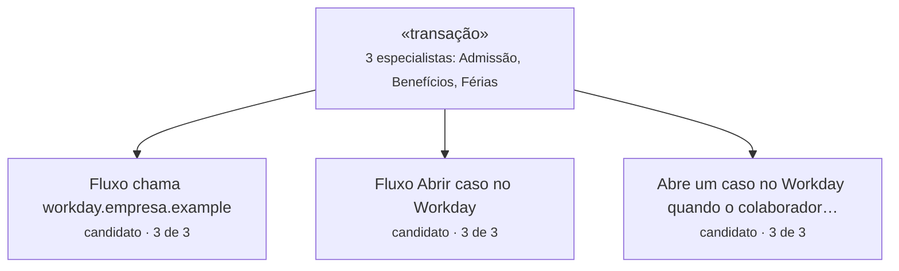

<details><summary>Como explicação (VS Code, Obsidian)</summary>

```visual-explainer-mermaid
flowchart TD
%% title O tipo «transação»
%% # O tipo «transação»
%% > Os padrões do tipo «transação» (aceitos ou ainda candidatos) e, em vermelho, quem está fora de cada um.
  %% title O tipo «transação»
  %% agent-review 2.3.0
  t["«transação»<br/><small>3 especialistas: Admissão, Benefícios, Férias</small>"]
  %% # Fluxo chama workday.empresa.example
  t --> q1["Fluxo chama workday.empresa.example<br/><small>candidato · 3 de 3</small>"]
  %% # Fluxo Abrir caso no Workday
  t --> q2["Fluxo Abrir caso no Workday<br/><small>candidato · 3 de 3</small>"]
  %% # Abre um caso no Workday quando o colaborador…
  t --> q3["Abre um caso no Workday quando o colaborador…<br/><small>candidato · 3 de 3</small>"]
  classDef bad fill:#fde2e1,stroke:#c0392b,color:#7b1d16,stroke-width:2px
  classDef amber fill:#fff3d6,stroke:#b7791f,color:#5c3d0b,stroke-width:2px
  classDef ok fill:#e3f4e8,stroke:#2f855a,color:#1c4532
  classDef ghost fill:#f4f4f4,stroke:#888,color:#555,stroke-dasharray:5 4
  classDef muted fill:#f4f4f4,stroke:#bbb,color:#666
```

</details>

### O tipo «orientação»

Os padrões do tipo «orientação» (aceitos ou ainda candidatos) e, em vermelho, quem está fora de cada um.

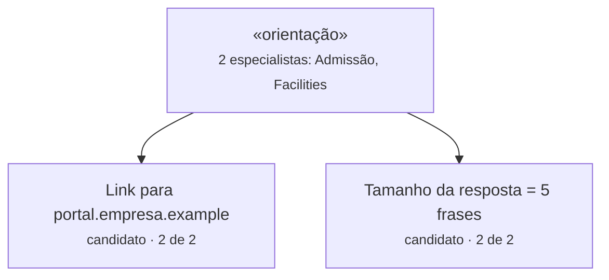

<details><summary>Como explicação (VS Code, Obsidian)</summary>

```visual-explainer-mermaid
flowchart TD
%% title O tipo «orientação»
%% # O tipo «orientação»
%% > Os padrões do tipo «orientação» (aceitos ou ainda candidatos) e, em vermelho, quem está fora de cada um.
  %% title O tipo «orientação»
  %% agent-review 2.3.0
  t["«orientação»<br/><small>2 especialistas: Admissão, Facilities</small>"]
  %% # Link para portal.empresa.example
  t --> q1["Link para portal.empresa.example<br/><small>candidato · 2 de 2</small>"]
  %% # Tamanho da resposta = 5 frases
  t --> q2["Tamanho da resposta = 5 frases<br/><small>candidato · 2 de 2</small>"]
  classDef bad fill:#fde2e1,stroke:#c0392b,color:#7b1d16,stroke-width:2px
  classDef amber fill:#fff3d6,stroke:#b7791f,color:#5c3d0b,stroke-width:2px
  classDef ok fill:#e3f4e8,stroke:#2f855a,color:#1c4532
  classDef ghost fill:#f4f4f4,stroke:#888,color:#555,stroke-dasharray:5 4
  classDef muted fill:#f4f4f4,stroke:#bbb,color:#666
```

</details>

### O tipo «triagem»

Os padrões do tipo «triagem» (aceitos ou ainda candidatos) e, em vermelho, quem está fora de cada um.

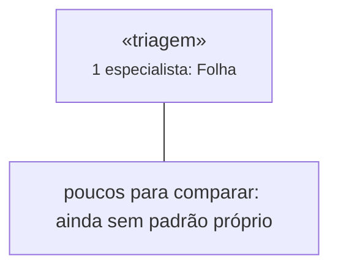

<details><summary>Como explicação (VS Code, Obsidian)</summary>

```visual-explainer-mermaid
flowchart TD
%% title O tipo «triagem»
%% # O tipo «triagem»
%% > Os padrões do tipo «triagem» (aceitos ou ainda candidatos) e, em vermelho, quem está fora de cada um.
  %% title O tipo «triagem»
  %% agent-review 2.3.0
  t["«triagem»<br/><small>1 especialista: Folha</small>"]
  t --- none["poucos para comparar: ainda sem padrão próprio"]
  classDef bad fill:#fde2e1,stroke:#c0392b,color:#7b1d16,stroke-width:2px
  classDef amber fill:#fff3d6,stroke:#b7791f,color:#5c3d0b,stroke-width:2px
  classDef ok fill:#e3f4e8,stroke:#2f855a,color:#1c4532
  classDef ghost fill:#f4f4f4,stroke:#888,color:#555,stroke-dasharray:5 4
  classDef muted fill:#f4f4f4,stroke:#bbb,color:#666
```

</details>

---

Escrito pelo agent-review 2.3.0.
