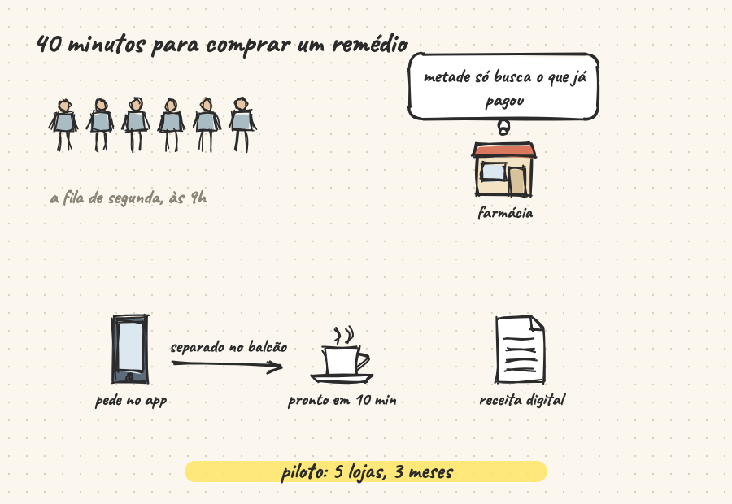

<h1 align="center">back-of-napkin</h1>

<p align="center"><b>Ask Claude to draw a pitch, an architecture, a decision, a number, what happened or a story. Get a hand-drawn board that draws itself, chapter by chapter, with a highlight at the end.</b></p>

<p align="center">
  
</p>

<p align="center">
  An <a href="https://agentskills.io">Agent Skill</a> for Claude Code, claude.ai, the Claude API and other tools that load skills.<br>
  <a href="https://ruinosus.github.io/house-lights/back-of-napkin/">Open the gallery</a> to play one drawing per purpose.
</p>

---

## What it does

The best explanation in a meeting is often a few strokes on a napkin: a queue, an arrow, the number that matters, and
what to do about it. back-of-napkin makes Claude draw that — not a diagram that is all there at once, but **one story
with a beginning and an end, told stroke by stroke, with a highlight at the end**.

It starts from **what the drawing is for** and follows an arc for each purpose:

| Purpose | For | What it usually misses (the build says so) |
|---|---|---|
| `pitch` | convincing someone to say yes | an ask at the end |
| `arch` | how a system works, for a client or a team | what happens when something goes down |
| `decision` | choosing between options | which option wins, and why |
| `data` | a number and what to do about it | where the numbers come from |
| `timeline` | what happened, in order (a post-mortem, a history) | the line itself |
| `story` | a case, a before and after | — |

Claude writes a short text **recipe** (`.chalk`), never the drawing; `scripts/build.mjs` checks it, says what the
purpose usually misses, draws it into **one HTML file that opens offline** and — with a headless browser — checks that
nothing leaves the paper and no text covers another.

## Present it

- **In the browser:** the page opens presenting — one chapter at a time on the whole screen; a clicker's PageDown
  moves on, PageUp back, Esc stops; the speaker notes (the narration, the next chapter, a clock) open in a window of
  their own, and the values still move.
- **PowerPoint:** `--pptx` makes a slide per chapter, `--pptx steps` one per beat (the drawing grows click by click),
  `--pptx video` a video of each chapter drawing itself (MP4); the narration goes as speaker notes, and `--settings`
  adds a sequence per setting.
- **Claude's Slides:** `--slides <folder>` gives a picture and a GIF per chapter and the notes, for the Slides type.

**back-of-napkin or chalk-talk?** To **teach** a concept — a class, «explain how X works by drawing» — use its sibling
[chalk-talk](https://github.com/ruinosus/house-lights), which draws a lesson. back-of-napkin is for drawing to
**present, convince, decide, document or tell what happened**. Both draw with the same engine.

## Install

back-of-napkin is one of the five skills of the [house-lights](../../README.md) plugin. **Claude Code:**

```
/plugin marketplace add ruinosus/house-lights
/plugin install house-lights@house-lights
```

Claude picks the skill by its description; to call it by name, `/house-lights:back-of-napkin`. **claude.ai**: upload
`back-of-napkin.zip` from the [latest release](https://github.com/ruinosus/house-lights/releases) in Settings › Capabilities ›
Skills (code execution on). **Claude API**: the same zip with the Skills API. **Other tools**: copy
`skills/back-of-napkin` where the tool reads skills; it needs Node.js 18 or later. **npm**: `npx house-lights back-of-napkin <file>`.

## Develop

```
npm install       # at the repository root: the five skills are npm workspaces
npm run assets -w dev/back-of-napkin/tools   # brings chalk-talk's engine from its npm package (never edit the generated files)
npm run check -w dev/back-of-napkin/tools    # SKILL.md, one version, the six examples drawn clean, one warning per purpose, the refusals
npm run linux -w dev/back-of-napkin/tools    # the six examples as in a cloud sandbox (Linux, root, Playwright's Chromium); needs Docker
npm run site -w dev/back-of-napkin/tools     # the gallery in docs/
npm run zip -w dev/back-of-napkin/tools      # dist/back-of-napkin.zip
```

## Third parties

The player is chalk-talk's (MIT): strokes by Rough.js (MIT); fonts Caveat and Shantell Sans (SIL Open Font License);
animated emoji from Noto Emoji Animation (CC BY 4.0, see `assets/lottie/NOTICE.md`), played by lottie-web (MIT). The
PowerPoint is made by pptxgenjs (MIT), with JSZip inside it (dual MIT or GPLv3; used under MIT).

## License

MIT. Every example is fictional.
