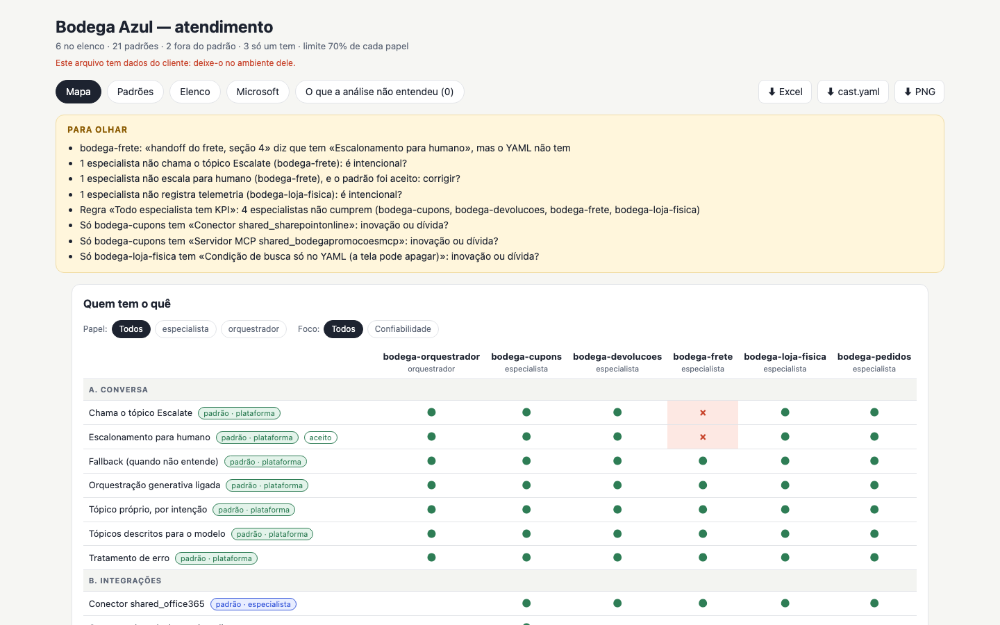

<h1 align="center">cast-list</h1>

<p align="center"><b>Point Claude at your Copilot Studio agents, cloned. See what they all do, who is off the pattern
and what only one has — with the file and line behind every finding.</b></p>

<p align="center">
  
</p>

<p align="center">
  An <a href="https://agentskills.io">Agent Skill</a> for Claude Code, claude.ai, the Claude API and other tools that load skills.<br>
  <a href="https://ruinosus.github.io/house-lights/cast-list/">Open the gallery</a> to click through the map, play the lesson and download the workbook.
</p>

---

## What it does

A team with many agents in Copilot Studio — an orchestrator and its specialists — needs to know **what repeats** (a
pattern to agree on), **who does it differently** (to correct, or to learn from) and **what is missing**, to set
architecture and delivery standards from evidence rather than opinion. cast-list reads the agents as the VS Code
extension clones them, compares them and shows it, with the file and line behind each finding. Once the team accepts a
pattern, every run checks it — on every agent, a new one included.

It runs on **Node alone**: no model, no install, no network. The client's data never leaves the machine, so it fits a
locked-down environment where a model has few credits or none.

## What you get

| | |
|---|---|
| **The map** (`.html`) | One page that opens offline: «to look at» on top; the matrix of facts by dimension (conversation, integrations, knowledge, orchestrator, governance) and agent — ● has it, × off a pattern, ◐ declared — filtered by role and focus area; the patterns to decide; a click shows who has it and the file and line. Tabs for the patterns, the cast, the Microsoft reference patterns and what was not understood. |
| **The workbook** (`.xlsx`) | Summary, Matrix, Patterns (with a Decision column to fill), Off pattern, Gaps, Conflicts, Cast, Evidence, Declared (to fill). Read back with `--from`, taken with `--take`. |
| **The lesson** (`.lesson.html`) | A chalk-talk lesson: the cast, what repeats, who is off, what is missing, what to decide. |
| **The cast file** (`.cast.yaml`) | What people declared (KPIs, owners, what a handoff claims) and what was decided — kept between runs. |

## How it decides

- **A pattern**: a fact in at least 70% of a role's agents, with at least 3 of them (the team's profile can change both).
  The **platform's** when the orchestrator has it too; the **specialists'** otherwise.
- **Off a pattern**: an agent of that scope without it. **Only one has it**: innovation or debt — someone has to say.
- **Rules**: what the team's profile says every agent of a role must have. **Conflicts**: what a document claims and
  the YAML does not show; what was seen wins.
- A child agent's facts are the child's. A file it cannot read — broken YAML, a kind Copilot Studio does not have — is
  told, and the rest is read anyway.

The keys and their names are in [references/keys.md](../../skills/cast-list/references/keys.md); the profile in
[references/profile.md](../../skills/cast-list/references/profile.md); the cast file in
[references/format.md](../../skills/cast-list/references/format.md).

## Install and use

cast-list is one of the six skills of the [house-lights](../../README.md) plugin. **Claude Code:**

```
/plugin marketplace add ruinosus/house-lights
/plugin install house-lights@house-lights
```

Then ask: "compare our Copilot Studio agents in ./agents". Or, with no Claude at all — in a clone of this repository,
or with npm:

```
node skills/cast-list/scripts/build.mjs agents/ --all --profile team.cast.yaml --lang pt
npx house-lights cast-list agents/ --all
```

The outputs hold the client's data: keep them in the client's environment. The
[Microsoft skills for Copilot Studio](https://github.com/microsoft/skills-for-copilot-studio) are recommended to
explain a kind or a pattern; cast-list works without them.

## Develop

```
npm install       # at the repository root: the six skills are npm workspaces
npm run assets -w dev/cast-list/tools   # scripts/engine.mjs, assets/map.html, the lesson page, references/keys.md
npm run check -w dev/cast-list/tools    # the engine's checks, the examples, the way back, a clean copy, no network
```

The source is `dev/cast-list/src/` (TypeScript); the example agents are fictional, made from Microsoft's MIT templates
(`dev/cast-list/fixtures/` has their answer key and the script that writes them).

## License

MIT. `skills/cast-list/vendor/microsoft/` holds the Copilot Studio schema and its reader from
microsoft/skills-for-copilot-studio, under its MIT license (see the NOTICE there).
