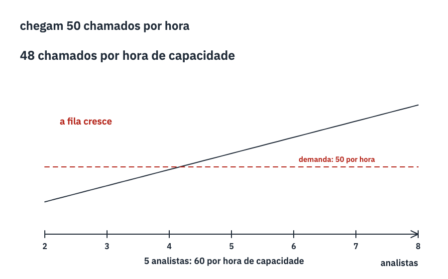
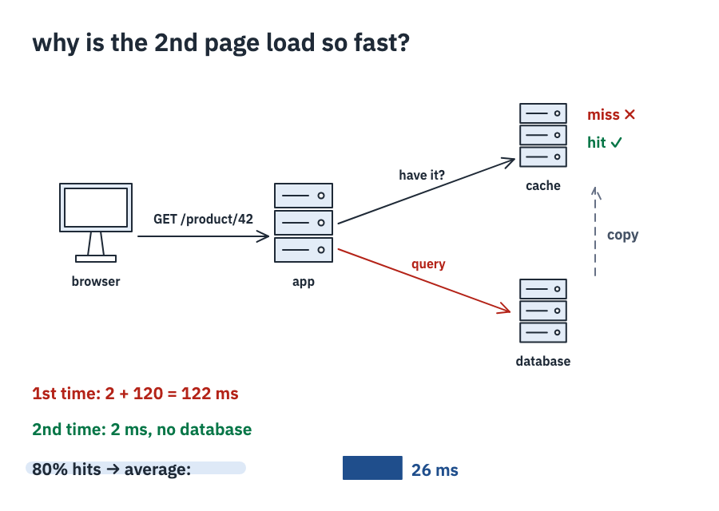
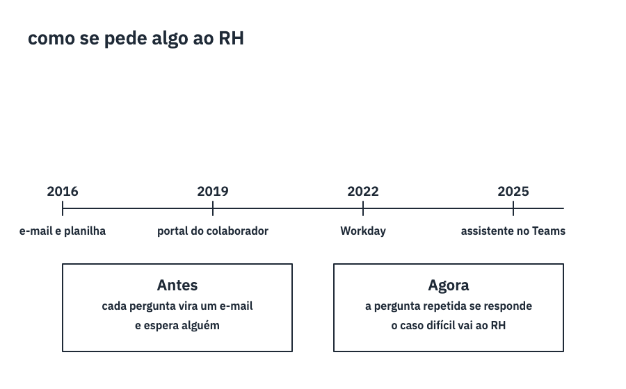
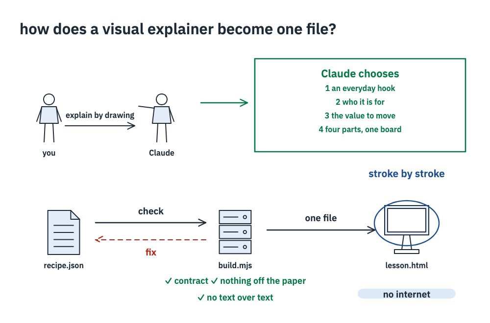
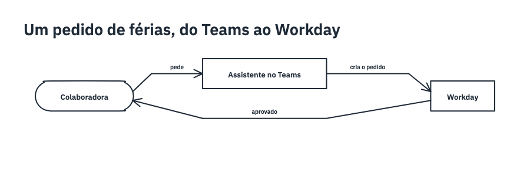
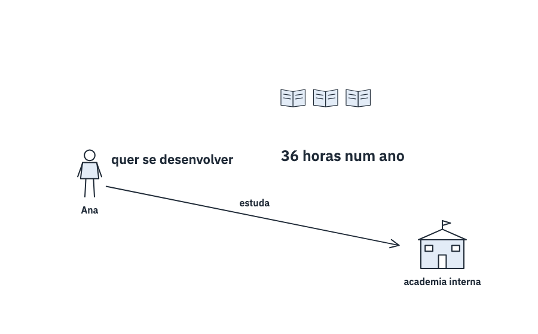
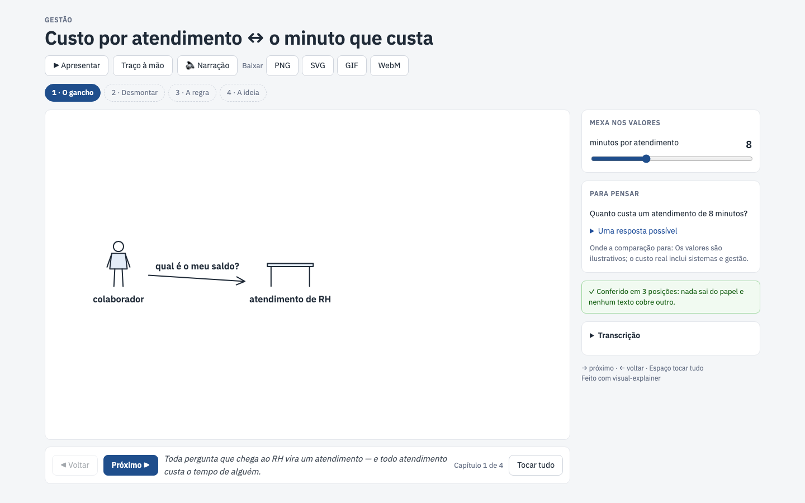
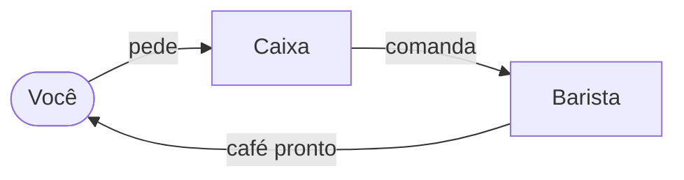

<h1 align="center">visual-explainer</h1>

<p align="center"><b>Ask Claude to explain something by drawing it — and get a lesson that draws itself, chapter by chapter, clean enough for a meeting room.</b></p>

<p align="center">
  
</p>

<p align="center">
  An <a href="https://agentskills.io">Agent Skill</a> for Claude Code, claude.ai, the Claude API and other tools that load skills.<br>
  The lesson is <b>one HTML file</b>: it opens offline, has chapters, narration and values you can move.
</p>

---

## What it draws

Every drawing below was made by Claude with this skill, from the one-line request under it, in the business theme
(the default; «Hand-drawn» switches any lesson to the pencil look).

<table>
  <tr>
    <td width="50%"></td>
    <td width="50%"></td>
  </tr>
  <tr>
    <td><i>«Explain by drawing why the HR help desk queue grows at payroll close.»</i><br>Move the analysts: the queue stops growing when the capacity passes the demand.</td>
    <td><i>«Can you draw how a web request with a cache works, for junior developers?»</i><br>Move the hit rate from 0 % to 90 % and watch the average time fall.</td>
  </tr>
  <tr>
    <td width="50%"></td>
    <td width="50%"></td>
  </tr>
  <tr>
    <td><i>«Draw how asking something of HR changed in ten years.»</i><br>A timeline and the two ways side by side.</td>
    <td><i>«Explain by drawing how this very skill works.»</i><br>Yes — visual-explainer drew its own diagram.</td>
  </tr>
  <tr>
    <td width="50%"></td>
    <td width="50%"></td>
  </tr>
  <tr>
    <td><i>A Mermaid flowchart</i>, as it is in the docs: each node and arrow drawn in order, a chapter per comment.</td>
    <td><i>«Explain by drawing how training hours add up in a year.»</i><br>Move the hours a month; the year's total counts up.</td>
  </tr>
</table>

**[Open the gallery](https://ruinosus.github.io/dna/visual-explainer/)** to play every lesson in your browser. The recipes behind
these drawings are in [`gallery/examples/`](gallery/examples). Build any of them with
`node skills/visual-explainer/scripts/build.mjs dev/visual-explainer/gallery/examples/web-cache.json`.

## The lesson you get

<p align="center"></p>

- **Chapters**: it opens on the first chapter and waits. *Next* draws the next part from where it stopped, *Play all*
  draws everything; the arrow keys and Space work too.
- **Narration**: one short sentence for each idea, under the paper.
- **Values to move**: sliders and switches beside the paper redraw it at once. Values only appear where there is a
  real quantity.
- **Think about it**: a new situation to think through, one possible answer, and where the comparison stops.
- **Checked**: when the file opens, it checks itself at the values' extremes. Nothing should leave the paper and no
  text should cover another.
- **Chalkboard**: a button turns the paper into a green board with chalk (or the recipe asks for it, for a class).
- **A question that waits**: the lesson can stop on a question until someone presses «Show me» — time for the class
  to answer.
- **Quiz** at the end: pick an option, see why it is right or not.
- **Narration** with the browser's own voice (off by default) and a **transcript** of everything the lesson says.
- **Download** the paper as PNG or SVG, or the lesson drawing itself as a **GIF** or a **video** (WebM) — for slides
  and messages.
- **Present**: one chapter at a time on the whole screen, a clicker's PageDown to move on, and the speaker notes (the
  narration, the next chapter, a clock) in a window of their own; the values still move. `build.mjs --present` opens
  the page that way.
- **PowerPoint**: `build.mjs --pptx` makes a slide per chapter, `--pptx steps` one per beat (the drawing grows click by
  click), `--pptx video` a video of each chapter drawing itself (MP4) — the narration as speaker notes, and
  `--settings` a sequence per setting. `--slides <folder>` gives the pictures, GIFs and notes for Claude's Slides.
- **Language**: the page speaks English or Portuguese, following the browser. Numbers in the drawing follow the
  recipe's language (`3.00` in English, `3,00` in Portuguese).
- **One file, about 265 KB**: engine, player, fonts and recipe are all inside. Open it without internet, send it by
  e-mail, project it in a class.

## How a conversation goes

Claude draws first: it picks the everyday thing to tie the idea to, who it is for and the value to move, builds the
lesson, and then says what it chose. A real answer from the evals (Claude Code, shortened):

> **You:** Draw the TCP three-way handshake.
>
> **Claude:** *(writes the recipe, builds it)* I've drawn the handshake: `lesson.html`, which opens offline.
> **What I chose:** I tied it to a phone call on a bad line ("Can you hear me?" / "Yes! Can you hear me?"), for a
> curious adult. There are two values to move: the client's starting number and the server's starting number. Want
> another hook, another audience or anything changed?
> The board has four chapters, and nothing is ever erased: why say hello three times; a client and a server, each with
> a line running down; the three messages — SYN, SYN-ACK, ACK; connected. Press Next to step through; in chapter 3,
> move the two starting numbers and watch each `ack` change to that number plus one.

For a class, students or a talk, Claude asks first — once, only what is missing — and shows the outline before drawing.
Afterwards it changes only what you ask («make the arrow blue», «use 5 % instead»). Ask for several lessons and they
come as **one course file**, with a list to go from one to the next.

## Write it as text — or bring a Mermaid diagram

A recipe can be a few lines of text instead of JSON, right inside your Markdown:

````markdown
```visual-explainer
title Juntar moedas ↔ o cofrinho
theme chalkboard
param n "moedas por mês" 1..8 = 3

# O gancho
> A Ana guarda moedas todo mês.
person ana at 150,330 "Ana" mood=idea
text "quer poupar" right-of ana gap 16 align=start

# Desmontar
row at 470,150 gap 14
  repeat n: coin size 44
bank banco at 740,450 "banco"
ana -> banco "deposita"
```
````

And a Mermaid diagram you already have becomes a hand-drawn lesson — any of its 30 kinds (all of Mermaid 11.17 but
zenuml): flowcharts and sequences, gantt and timelines, mind maps, sankey, C4, wardley maps and the rest. The `%%` lines are comments for Mermaid, so the same block still shows as a normal diagram on GitHub:

````markdown

````

`node skills/visual-explainer/scripts/build.mjs page.md` turns every such block into a lesson. The whole syntax:
[references/text.md](../../skills/visual-explainer/references/text.md).

### In your docs site

On a docs site the lesson plays inside the page — ` ```visual-explainer ` for the text, ` ```visual-explainer-mermaid ` for a Mermaid
diagram (a plain ` ```mermaid ` is left to the site). The `@ruinosus/visual-explainer` npm package has a remark and a markdown-it plugin,
and the script that mounts the lessons. With Docusaurus:

```js
// docusaurus.config.js
import { remarkVisualExplainer } from '@ruinosus/visual-explainer/markdown'
export default {
  // …
  presets: [['classic', { docs: { remarkPlugins: [remarkVisualExplainer] } }]],
  clientModules: ['visual-explainer/mount.global.js'],
}
```

The lesson opens on chapter 1, drawn and still; **Expand** shows all of it.

The same blocks play in the **VS Code** Markdown preview ([vscode-visual-explainer](https://github.com/ruinosus/vscode-visual-explainer))
and in **Obsidian** notes ([obsidian-visual-explainer](https://github.com/ruinosus/obsidian-visual-explainer)). Neither is in its
store yet: build and install them by hand, as their READMEs say.

### On GitHub: an SVG that draws itself

GitHub shows no script in a README, but it shows an image — and an SVG can animate itself with CSS. `--svg` draws the
lesson into one:

```
npx @ruinosus/visual-explainer time-off-request.mmd --svg   # → time-off-request.svg
```

<p align="center"></p>

It plays once when the page opens and stays as the finished drawing (still from the start for someone who asked for
less motion). It has no chapters, values or narration — link to the `.html` lesson for those. To keep the SVGs in step
with the recipes, a workflow like this one draws them on every push:

```yaml
name: Draw the visual-explainer SVGs
on:
  push:
    paths: ['**/*.chalk', '**/*.mmd']
permissions:
  contents: write
jobs:
  draw:
    runs-on: ubuntu-latest   # has Chrome, which draws them
    steps:
      - uses: actions/checkout@v4
      - uses: actions/setup-node@v4
        with: { node-version: 22 }
      - run: git ls-files '*.chalk' '*.mmd' | while read -r f; do npx -y @ruinosus/visual-explainer@0.21.0 "$f" "${f%.*}.svg" --svg; done
      - run: |
          git config user.name github-actions
          git config user.email github-actions@users.noreply.github.com
          git add -A -- '*.svg'
          git diff --cached --quiet || { git commit -m "Draw the visual-explainer SVGs" && git push; }
```

## How it works

Claude never writes the drawing itself. It writes a small **recipe** — JSON that says what to draw, step by step:

```json
{ "id": "custo-atendimento", "title": "Custo por atendimento ↔ o minuto que custa", "locale": "pt-BR",
  "params": { "minutos": { "label": "minutos por atendimento", "min": 2, "max": 20, "step": 1, "value": 8 } },
  "steps": [
    { "type": "prop", "name": "person", "at": [120, 300], "label": "colaborador",
      "chapter": "O gancho", "say": "Toda pergunta que chega ao RH vira um atendimento — e todo atendimento custa o tempo de alguém." },
    { "type": "prop", "name": "desk", "id": "rh", "at": [420, 300], "label": "atendimento de RH" },
    { "type": "counter", "at": [640, 300], "value": "custo", "format": "R$ {v:0} por atendimento", "chapter": "Desmontar" },
    …
```

Then `scripts/build.mjs` (plain Node, no dependencies):

1. **checks the contract**: step types, sizes, expressions, colours. A broken recipe stops here with a message
   Claude can act on — the line, what is wrong and how that kind of line is written (exit 1).
2. **builds one HTML file**: the player with the engine and fonts inside, plus the recipe.
3. **reviews the drawing** in a headless Chrome, Chromium or Edge — Playwright's Chromium too, so it works in cloud
   sandboxes — in a second or two. The drawing is checked hidden at each value's extremes: anything off the paper,
   text over text, a line through a text. Problems go back to Claude (exit 3), at most twice. Without a browser, the
   page checks itself when opened.
4. with `--snapshots`, **draws pictures to look at**: each chapter as it ends at each value's extremes, and a contact
   sheet with them all (a row per chapter, a column per setting). Claude opens it in the round of fixes, to see what
   the numbers of the review cannot say.

What a recipe can draw: text, lines and arrows, curves and polygons, circles, plots of a formula, a yellow marker,
labelled cards, 45 hand-drawn props (`person`, `house`, `bus`, `coin`, `phone`, `server`, `bank`, `school`, `hospital`,
`truck`, `database`, `robot`, `ship`, `warehouse`, `shop`, `cup`, `cluster`, `board`, `book`…) and props a recipe makes
itself from shapes (`define`) — a person can look happy, sad, surprised, worried or have an idea — repeated pieces (`repeat`), pieces that appear on a condition (`when`), movement (`move`), things that keep moving in place (`animate`: spin, drive, steam, talk, pulse, float), a ready-made animated emoji or Lottie file (`lottie`), arrows
between named pieces (`link`, or `a -> b -> c` in the text), a chain of things that pass something along, spread over
the paper and joined in order (`chain`), numbers that count up (`counter`), axes with marks (`axis`), timelines (`timeline`),
speech and thought balloons (`balloon`), curly braces (`brace`), handwritten notes with an arrow (`note`), tables
(`table`) and bars (`bars`). Positions can be expressions over the values, so the drawing follows the sliders — or be left to the
engine: `place` puts a piece beside another by name, and `row`, `column` and `grid` line pieces up. A piece that would
leave the paper comes back in on its own. The full contract is in
[`references/recipe.md`](../../skills/visual-explainer/references/recipe.md).

## Install

visual-explainer is one of the six skills of the [dna](../../README.md) plugin. **Claude Code:**

```
/plugin marketplace add ruinosus/dna
/plugin install dna@dna
```

Or copy `skills/visual-explainer` to `~/.claude/skills/`.

**claude.ai**: download `visual-explainer.zip` from the [latest release](https://github.com/ruinosus/dna/releases),
then Settings › Capabilities › Skills › Upload. Code execution must be on. The lesson comes back as a file to download.

**Claude API**: upload the same zip with the Skills API (`/v1/skills`) and use it with the code execution tool.

**Without installing anything** — on npm as [`visual-explainer`](https://www.npmjs.com/package/@ruinosus/visual-explainer): a page needs
only the recipe and `<script src="https://cdn.jsdelivr.net/npm/@ruinosus/visual-explainer@0.21.0/player.js"></script>` (that is also
how the skill shows a lesson where it cannot run code), and `npx @ruinosus/dna visual-explainer lesson.json` builds the one-file lesson.

**Other tools** (Codex, GitHub Copilot, Cursor, Gemini CLI…): copy `skills/visual-explainer` to the folder where the tool
reads skills (for example `.agents/skills/`). The tool needs Node.js 18 or later.

> **Tip:** Claude picks a skill by its description. If you have a very long list of skills installed, Claude Code may
> show it only the names. In that case, call it by name: `/dna:visual-explainer explain … by drawing it` (or
> `/visual-explainer …` when the folder was copied to `~/.claude/skills/`).

## What is inside

```
skills/visual-explainer/
  SKILL.md                 how Claude runs the conversation
  references/              how to write a recipe, the molds, the hooks, seven example recipes
  scripts/build.mjs        checks a recipe and builds the HTML (Node 18+, no dependencies)
  scripts/pptx.mjs         the PowerPoint maker, loaded only for --pptx ┐
  scripts/contract.mjs     the recipe contract          │
  assets/player.html       the player, engine and fonts ┘ generated — do not edit
gallery/                   the gallery's example recipes and hand-made pictures (the site in docs/ is made from them)
tools/                     builds the generated files, checks and packs the skill
```

The drawing engine uses [Rough.js](https://roughjs.com) (MIT) for the hand-drawn strokes. The fonts are
[Caveat](https://fonts.google.com/specimen/Caveat) and [Shantell Sans](https://fonts.google.com/specimen/Shantell+Sans)
(SIL Open Font License). All three are bundled into `assets/player.html`.

## Not yet

Voice narration, editing the drawing by hand, PDF export, «appear on click» animations inside the PowerPoint, and showing the lesson inline as a claude.ai artifact
(today it comes back as a file).

## Develop

```
npm install       # at the repository root: the six skills are npm workspaces
npm run assets -w dev/visual-explainer/tools    # rebuild the generated files from the engine's source (paths in tools/sources.json)
npm run check -w dev/visual-explainer/tools     # build every example and check the exit codes
npm run snapshots -w dev/visual-explainer/tools # draw every example in a headless browser and compare its SVG with tools/snapshots/
npm run zip -w dev/visual-explainer/tools       # dist/visual-explainer.zip for claude.ai and the API
npm run site -w dev/visual-explainer/tools      # the gallery in docs/ (GitHub Pages): every example as a lesson, with a picture
npm run linux -w dev/visual-explainer/tools     # the review as in a cloud sandbox: Linux, as root, Playwright's Chromium (needs Docker)
npm run audit     # before a push: no name from your local list in the tracked files
```

## The kit (`visual-explainer/kit`)

The skills built the way visual-explainer is ([way-of-working](https://github.com/ruinosus/dna),
[incident-drill](https://github.com/ruinosus/dna), [service-blueprint](https://github.com/ruinosus/dna))
share what is not their own format: it ships in this package as `visual-explainer/kit`, and is used when a skill is built,
never installed with it — a skill carries the files it runs.

- **Copied into each skill:**
  - `browser.mjs`: a headless Chrome, Chromium or Edge over the DevTools pipe, Playwright's Chromium included, the
    next browser when one fails; it reads what a page writes or takes a picture of it;
  - `page.mjs`: JSON safe inside a `<script>`, and a template filled.
- **Bundled into each skill's engine:** `format.ts`, which reads YAML so every mistake can say its line.
- **Tools:** `tools/vendor.mjs`, `zip.mjs`, `gallery.mjs` (the Pages pictures, drawn by the page), `checks.mjs`,
  `audit.mjs` (names from `~/.config/skill-kit/audit.txt`, a list kept out of every repository),
  `eval-metrics.mjs` and `linux-check.mjs`.
- **`SKILL.template.md`:** the shape these skills share, for the next one.

`assets/VERSION` says which engine version the generated files came from. The engine's source is not published
yet, so `npm run assets` only works where it is; everything else (`check`, `snapshots`, `site`, `zip`) works from
this repository alone.

The skill's own evals are in [`evals/`](../../evals): 26 requests in English and Portuguese (drawing at once, drawing for a
class, crowded papers, changing a lesson, requests that are not about drawing, and six fixed requests that measure
speed). They run with [`claude plugin eval`](https://docs.claude.com/en/docs/claude-code):

```
claude plugin eval . --allow-tools Bash Write Edit --runs 1 --max-cost-usd 15
claude plugin eval . --ablation none --allow-tools Bash Write Edit --tag speed --runs 2 --keep-temp --json run.json
node kit/tools/eval-metrics.mjs run.json    # seconds to the first drawing, files read first, rounds of fixes, quality
```

Speed, 0.11.0 → 0.17.1 (Claude Code, two runs per request; 0.11.0 with the outline already approved, its best case):
the first drawing in **28–41 s instead of 49–70 s**, with **no reference file read** before writing instead of 3 or 4.
The class request still asks first. [`evals/speed-cloud.md`](../../evals/visual-explainer-speed-cloud.md) is the same measure by hand in
claude.ai.

## Third-party

- [lottie-web](https://github.com/airbnb/lottie-web) (light build, MIT) goes into a lesson only when it plays an
  animation.
- The animated emoji in `skills/visual-explainer/assets/lottie/` are **Animated Noto Emoji by Google**, under
  [CC BY 4.0](https://creativecommons.org/licenses/by/4.0/) — not MIT; a lesson that plays one credits it.
- Rough.js (MIT); the fonts Caveat and Shantell Sans (SIL Open Font License).
- [pptxgenjs](https://github.com/gitbrent/PptxGenJS) (MIT) is bundled into `scripts/pptx.mjs`, with JSZip inside it
  (dual MIT or GPLv3; used under MIT).

## License

MIT
