# Bodega Azul — atendimento: o que o cast-list leu

> Estes diagramas têm dados do cliente: deixe este arquivo no ambiente dele.

6 no elenco (1 orquestrador, 5 especialistas) · 38 padrões · 3 fora do padrão · 4 só um tem

## Para olhar

### Contradições · 2

- bodega-frete: «handoff do frete, seção 4» diz que tem «Escalonamento para humano», mas o YAML não tem
- bodega-devolucoes tem «Só o conhecimento», mas também «Conhecimento geral do modelo ligado» (regra «Quem pede só o conhecimento tem o conhecimento geral desligado»)

### Contrato e telemetria · 6

- bodega-cupons registra «bodega_cupons_onerror»; os outros, «‹nome›_OnError»: é o mesmo evento?
- O orquestrador chama «Bodega Azul - Fidelidade», que não está na pasta
- A descrição de roteamento de bodega-cupons tem só 7 caracteres
- O fluxo «Abrir chamado no ERP» de bodega-cupons não devolve nada
- O evento «BodegaFrete_OnError» de bodega-frete não disparou em 30 dias
- bodega-loja-fisica não tem nenhuma linha na telemetria: está ligado ao Application Insights?

### Fora do padrão · 10

- 1 especialista registra «‹nome›_OnError» sem «ConversationId» (bodega-cupons): é intencional?
- 1 especialista não recebe o histórico da conversa do orquestrador (bodega-frete): é intencional?
- 1 especialista não recebe «CategoriaSolicitacao» do orquestrador (bodega-frete): é intencional?
- 1 especialista tem uma variação do bloco oficial «Formatação de links» (bodega-frete): alinhar?
- 1 especialista não escala para humano (bodega-frete), e o padrão foi aceito: corrigir?
- 1 especialista não registra telemetria (bodega-loja-fisica): é intencional?
- 1 especialista não tem «Sem emojis» (bodega-loja-fisica): é intencional?
- 4 especialistas definem «Tamanho da resposta» de 2 jeitos (3 bullets em 3; 5 frases em 2): unificar?
- bodega-loja-fisica define «Tamanho da resposta» duas vezes (3 bullets; 5 frases): qual vale?
- O tipo «triagem» tem 1 especialista (bodega-frete): nada a comparar dentro dele

### Regras · 1

- Regra «Todo especialista tem KPI»: 1 especialista não cumpre (bodega-loja-fisica)

### Só um tem · 4

- Só bodega-cupons tem «Conector SharePoint»: inovação ou dívida?
- Só bodega-cupons tem «Servidor MCP Bodega Azul Promocoes MCP»: inovação ou dívida?
- Só bodega-frete tem «Desambiguação («você quis dizer…»)»: inovação ou dívida?
- Só bodega-loja-fisica tem «Condição de busca só no YAML (a tela pode apagar)»: inovação ou dívida?

### Sem uso · 4

- Ninguém usa a variável «PreferenciaAntiga» (bodega-frete): remover?
- Ninguém chama o fluxo «Listar lojas» (bodega-loja-fisica): remover ou ligar?
- Ninguém chama o tópico «AvisoAntigo» (bodega-loja-fisica): remover ou ligar?
- bodega-pedidos tem um nó desligado em «topics/Escalate» (SendActivity): remover?

## Os diagramas

Cada diagrama também está sozinho em `bodega-azul.diagrams/`, para colar onde o Mermaid for lido.

### Topologia

Quem atende o cliente e o que cada um alcança. Setas grossas são chamadas; finas, o que cada um usa (um fluxo, um sistema); tracejadas, o que ninguém chama ou não está na pasta. Em vermelho o que falta numa chamada; em âmbar, uma descrição de roteamento curta ou um fluxo que não devolve nada. Os números são os inícios de tópico na telemetria.

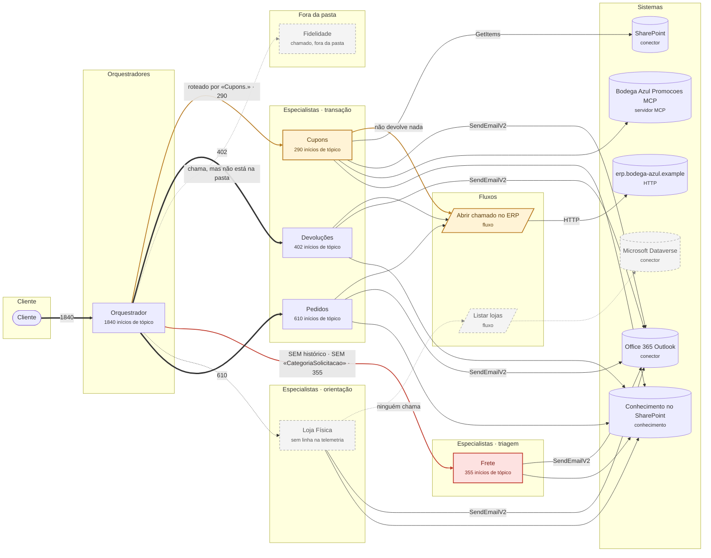

### A chamada para Cupons

O que acontece, passo a passo, quando o orquestrador encaminha para Cupons. ⚠ marca o que olhar.

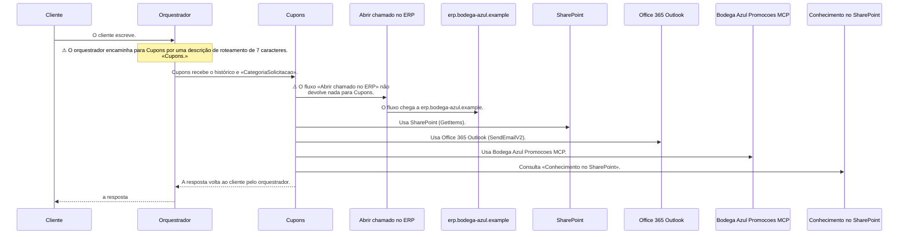

### A chamada para Devoluções

O que acontece, passo a passo, quando o orquestrador encaminha para Devoluções. ⚠ marca o que olhar.

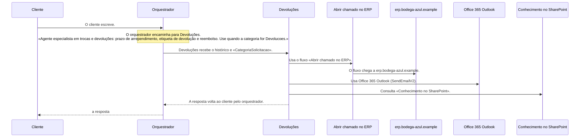

### A chamada para Fidelidade

O que acontece, passo a passo, quando o orquestrador encaminha para Fidelidade. ⚠ marca o que olhar.

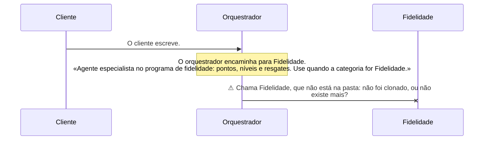

### A chamada para Frete

O que acontece, passo a passo, quando o orquestrador encaminha para Frete. ⚠ marca o que olhar.

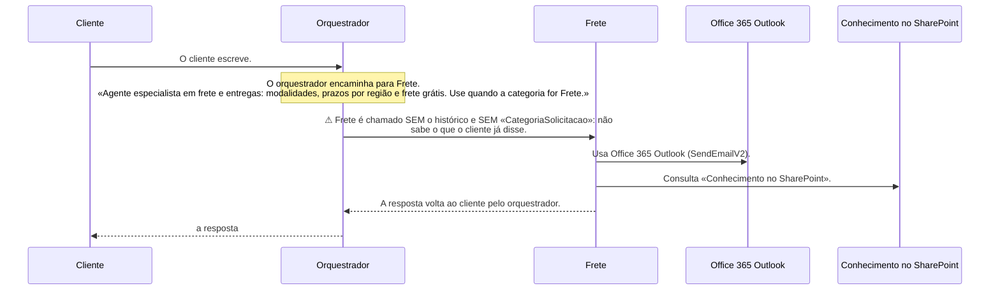

### A chamada para Loja Física

O que acontece, passo a passo, quando o orquestrador encaminha para Loja Física. ⚠ marca o que olhar.

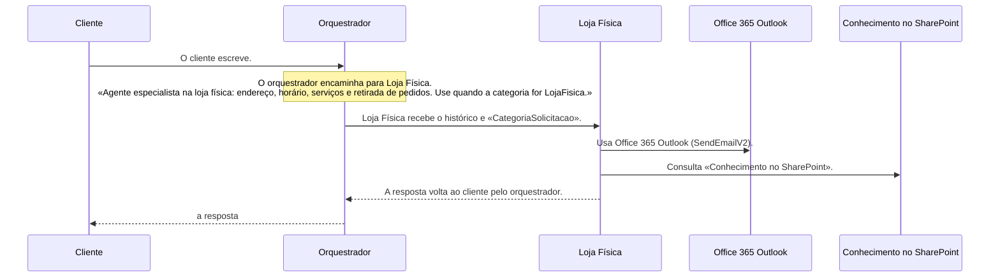

### A chamada para Pedidos

O que acontece, passo a passo, quando o orquestrador encaminha para Pedidos. ⚠ marca o que olhar.

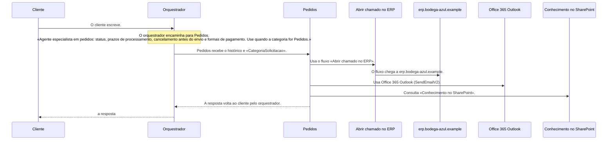

### Lente: Escalonamento para humano

«Escalonamento para humano» — padrão de plataforma (5 de 6). Fora: Frete.

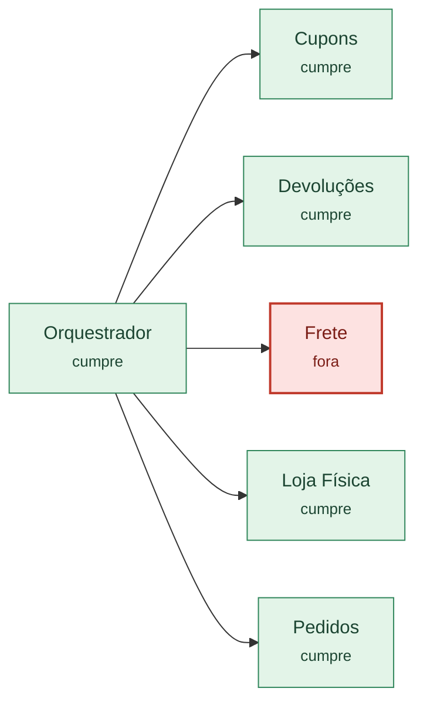

### Lente: Registra telemetria

«Registra telemetria» — padrão de plataforma (5 de 6). Fora: Loja Física.

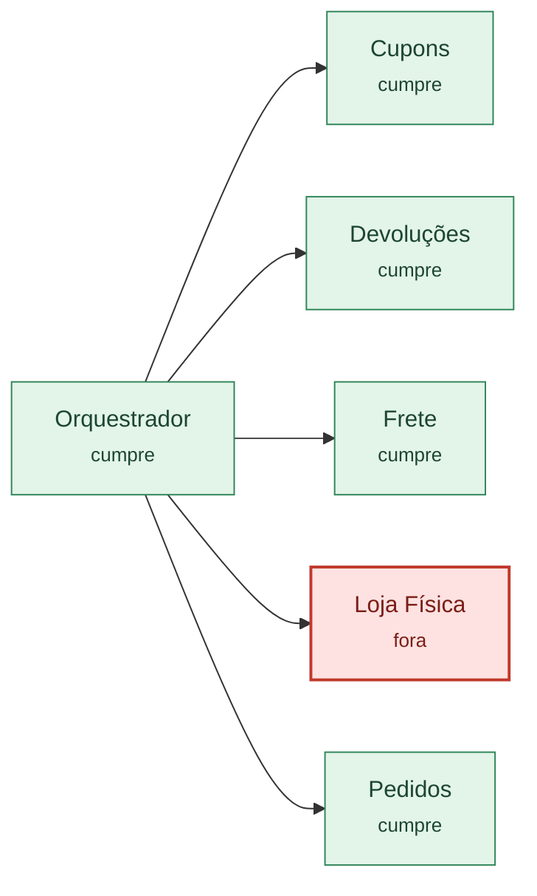

### Lente: Sem emojis

«Sem emojis» — padrão de plataforma (5 de 6). Fora: Loja Física.

### Lente: Recebe o histórico da conversa

«Recebe o histórico da conversa» — padrão dos especialistas (4 de 5). Fora: Frete.

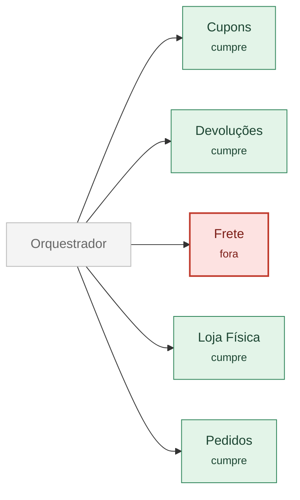

### Lente: Recebe «CategoriaSolicitacao» do orquestrador

«Recebe «CategoriaSolicitacao» do orquestrador» — padrão dos especialistas (4 de 5). Fora: Frete.

### Lente: Formatação de links

«Formatação de links» — padrão dos especialistas (4 de 5). Variação: Frete.

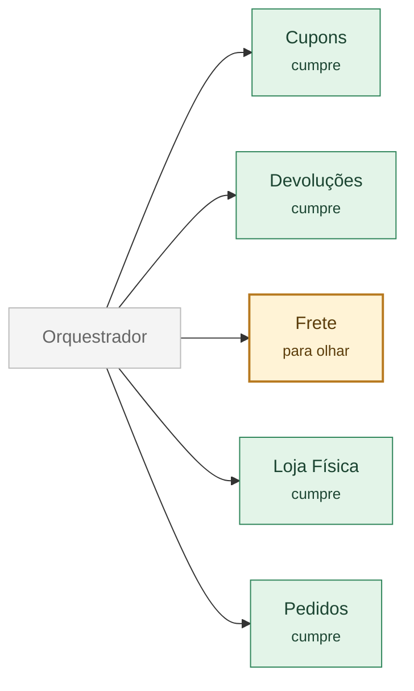

### Lente: Contrato

O que o orquestrador passa, e como encaminha: em vermelho o que falta; em âmbar, uma descrição de roteamento curta ou um fluxo que não devolve nada.

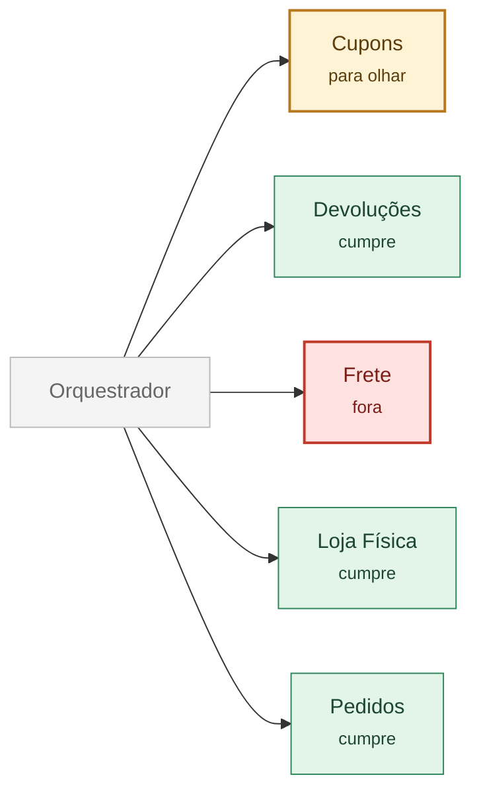

### Lente: Telemetria

Quem registra, e o que dispara: em vermelho quem não registra ou não tem linha; em âmbar um evento escrito de outro jeito, um campo que falta ou um evento que não disparou.

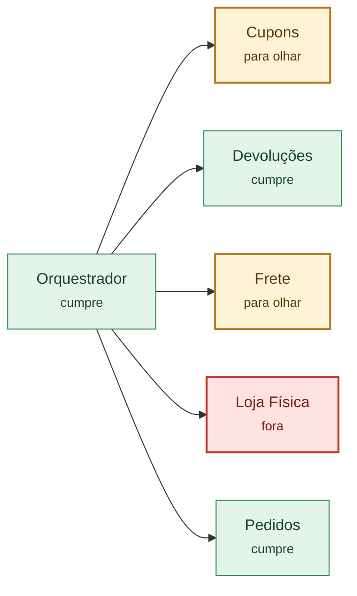

### Lente: Sem uso

O que ninguém usa, ou está desligado: remover ou ligar?

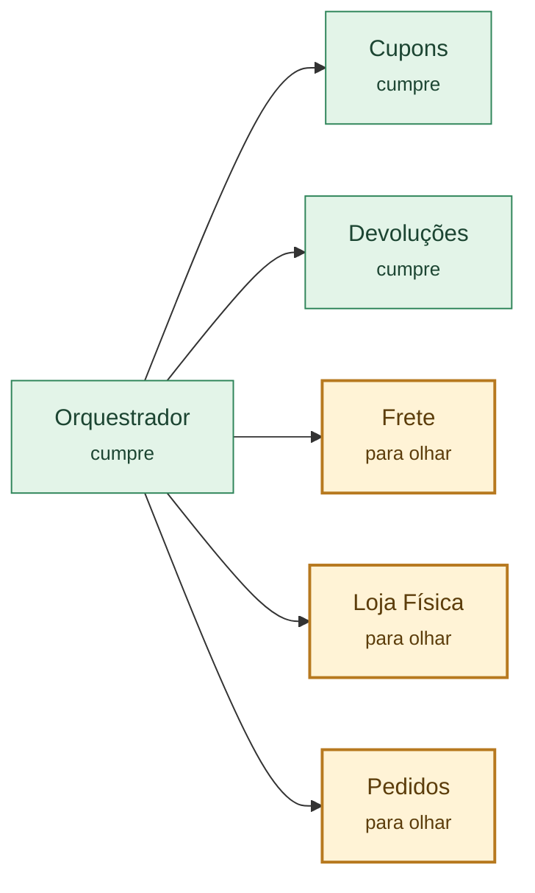

### O tipo «transação»

Os padrões do tipo «transação» (aceitos ou ainda candidatos) e, em vermelho, quem está fora de cada um.

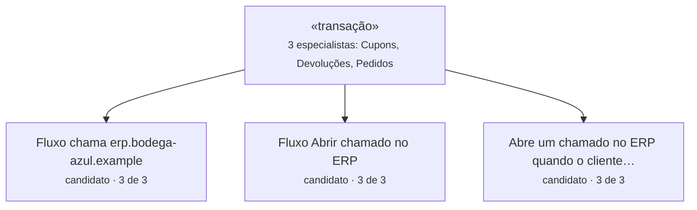

### O tipo «orientação»

Os padrões do tipo «orientação» (aceitos ou ainda candidatos) e, em vermelho, quem está fora de cada um.

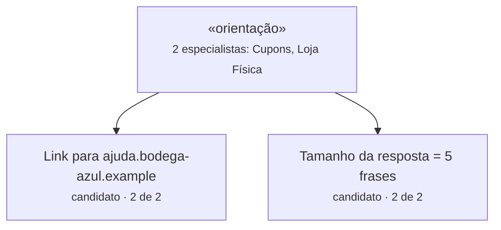

### O tipo «triagem»

Os padrões do tipo «triagem» (aceitos ou ainda candidatos) e, em vermelho, quem está fora de cada um.

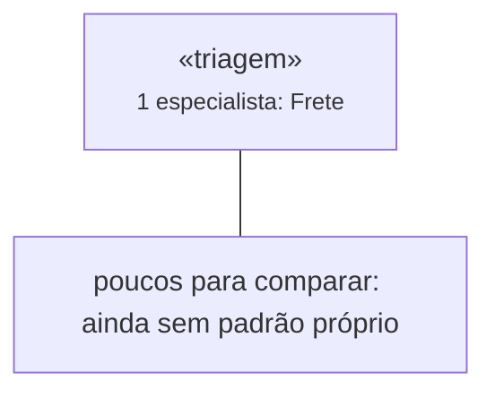

---

Escrito pelo cast-list 1.11.0.
