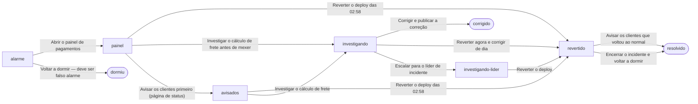

# Roteiro do facilitador: Checkout fora do ar às 3h

O pagamento da loja começa a falhar de madrugada, logo depois de um deploy.

Feito a partir de `runbooks/checkout.md`.

Começa às **03:12** · impacto contado em pedidos perdidos.

## Papéis

- **Plantonista** — quem joga
- **Líder de incidente**
- **Release** · pode: reverter-deploy
- **Comunicação** · pode: pagina-de-status

## Os caminhos



<details><summary>Como explicação (VS Code, Obsidian)</summary>

```visual-explainer-mermaid
flowchart LR
%% title Checkout fora do ar às 3h
%% # Os caminhos
%% > Cada escolha leva a uma cena; começa em alarme.
  s0["alarme"]
  s1["painel"]
  s2(["dormiu"])
  s3["revertido"]
  s4["investigando"]
  s5["avisados"]
  s6(["resolvido"])
  s7(["corrigido"])
  s8["investigando-lider"]
  s0 -->|"Abrir o painel de pagamentos"| s1
  s0 -->|"Voltar a dormir — deve ser falso alarme"| s2
  s1 -->|"Reverter o deploy das 02:58"| s3
  s1 -->|"Investigar o cálculo de frete antes de mexer"| s4
  s1 -->|"Avisar os clientes primeiro (página de status)"| s5
  s3 -->|"Avisar os clientes que voltou ao normal"| s6
  s3 -->|"Encerrar o incidente e voltar a dormir"| s6
  s4 -->|"Corrigir e publicar a correção"| s7
  s4 -->|"Reverter agora e corrigir de dia"| s3
  s4 -->|"Escalar para o líder de incidente"| s8
  s5 -->|"Reverter o deploy das 02:58"| s3
  s5 -->|"Investigar o cálculo de frete"| s4
  s8 -->|"Reverter o deploy"| s3
```

</details>

## Cenas

### alarme

O alarme de erros no pagamento toca no seu celular.

- **Abrir o painel de pagamentos** → painel _(+2 min · runbook §1)_
- **Voltar a dormir — deve ser falso alarme** → dormiu _(+25 min · +1500 pedidos perdidos)_

### painel

O painel mostra 42% de erros no pagamento desde 03:09. O último deploy foi às 02:58 — uma mudança no cálculo de frete. O banco responde normal.

> **03:16** O atendimento escreve no canal — três clientes reclamando no Twitter que não conseguem pagar.

- **Reverter o deploy das 02:58** → revertido _(+4 min · +150 pedidos perdidos · precisa de reverter-deploy · runbook §2)_
- **Investigar o cálculo de frete antes de mexer** → investigando _(+14 min · +900 pedidos perdidos)_
- **Avisar os clientes primeiro (página de status)** → avisados _(+3 min · +120 pedidos perdidos · precisa de pagina-de-status · avisa os afetados)_

### dormiu — fim: piorou

Às 03:37 o gerente liga — o checkout está fora há meia hora e ninguém respondeu ao alarme.

### revertido

O deploy é revertido. Em dois minutos os erros caem para 0%.

- **Avisar os clientes que voltou ao normal** → resolvido _(+3 min · precisa de pagina-de-status · avisa os afetados)_
- **Encerrar o incidente e voltar a dormir** → resolvido _(+1 min)_

### investigando

Você acha o problema — o cálculo de frete quebra para CEPs da região Norte. Corrigir no código leva tempo.

- **Corrigir e publicar a correção** → corrigido _(+30 min · +1200 pedidos perdidos)_
- **Reverter agora e corrigir de dia** → revertido _(+4 min · +150 pedidos perdidos · precisa de reverter-deploy · runbook §2)_
- **Escalar para o líder de incidente** → investigando-lider _(+3 min · chama Líder de incidente · runbook §4)_

### avisados

A página de status diz «instabilidade no pagamento». Os erros seguem em 42%.

- **Reverter o deploy das 02:58** → revertido _(+4 min · +150 pedidos perdidos · precisa de reverter-deploy · runbook §2)_
- **Investigar o cálculo de frete** → investigando _(+14 min · +900 pedidos perdidos)_

### resolvido — fim: resolvido

O checkout está normal de novo.

### corrigido — fim: resolvido

A correção entra no ar. O pagamento volta — mas a loja ficou quase uma hora sem vender para o Norte.

### investigando-lider

O líder de incidente entra e pergunta por que o deploy ainda não foi revertido.

- **Reverter o deploy** → revertido _(+4 min · +150 pedidos perdidos · precisa de reverter-deploy · runbook §2)_

## O que o runbook não diz

- O runbook não diz quem avisa os clientes, nem quando. _(runbook inteiro)_
- O §2 manda reverter no painel de deploy, mas o plantonista não tem esse acesso — só o Release. _(§2)_
- O §4 diz «escale» e não diz para quem, nem como. _(§4)_
